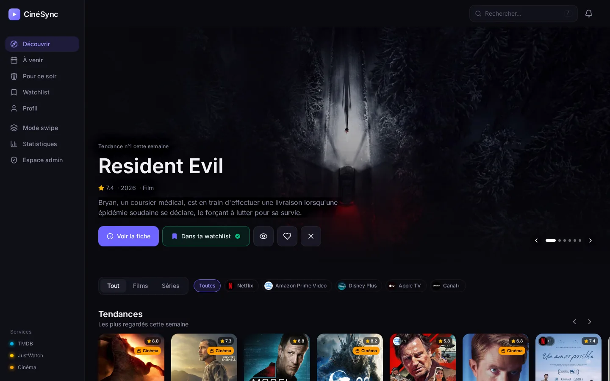
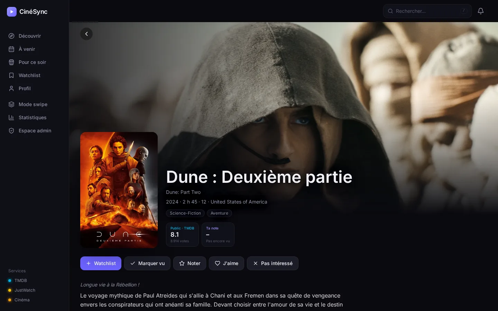
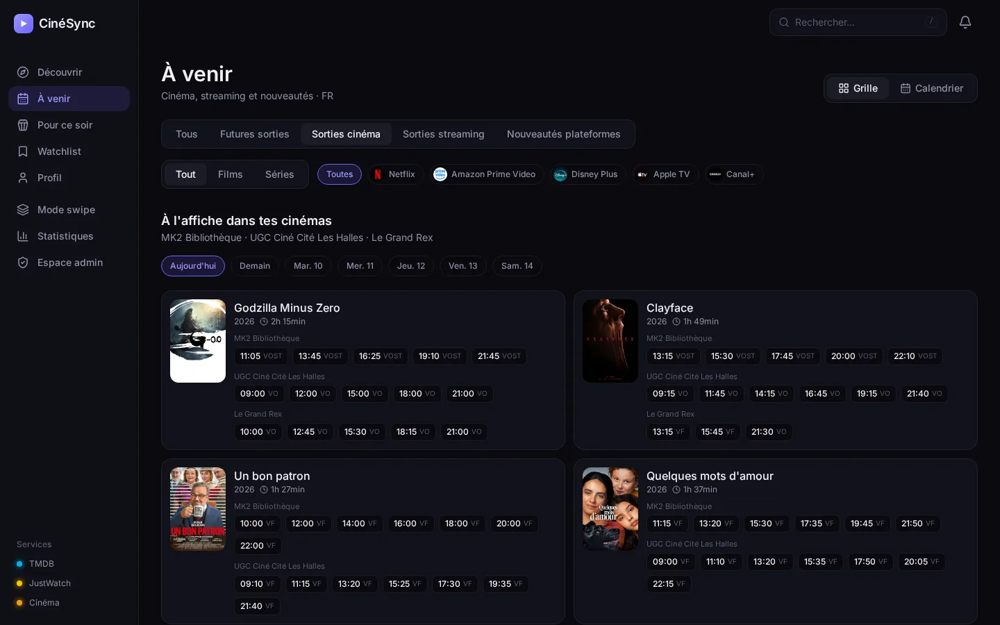
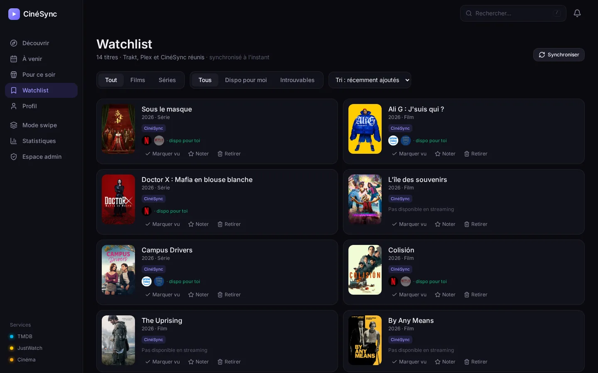
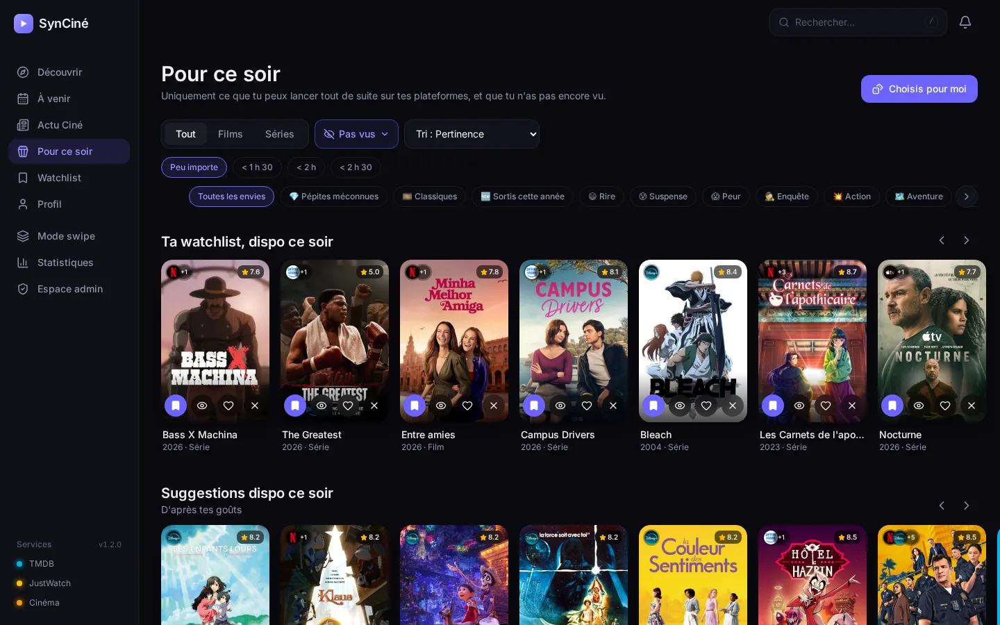
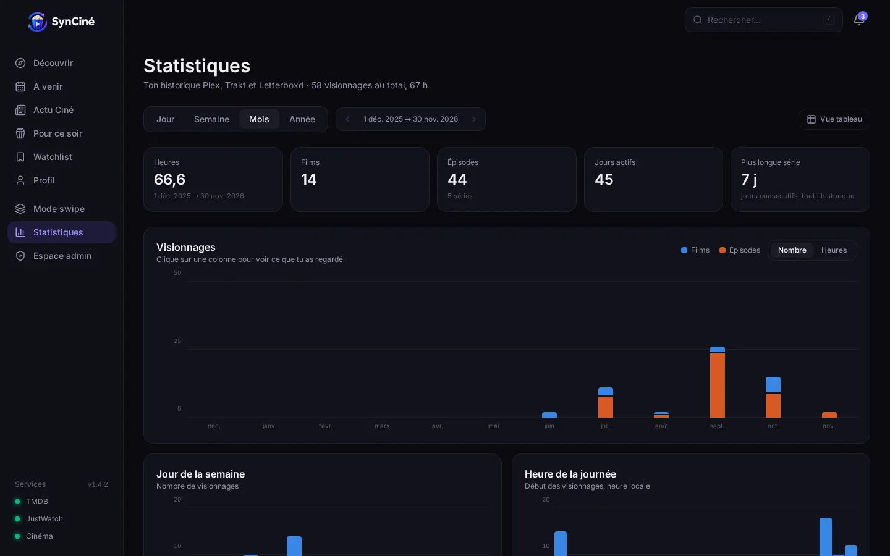
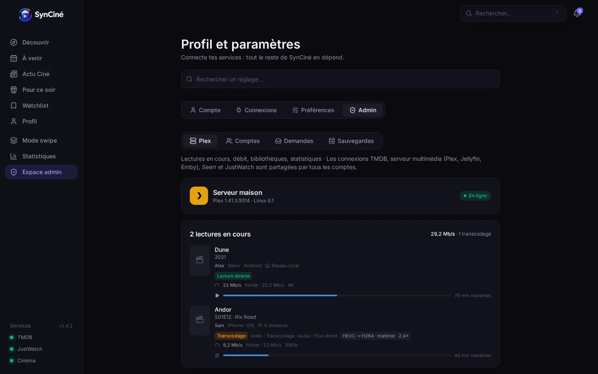
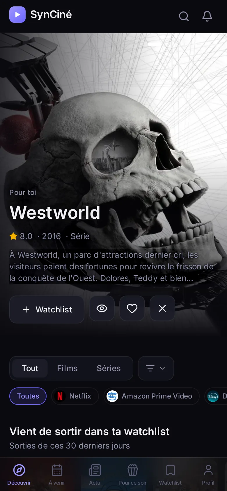
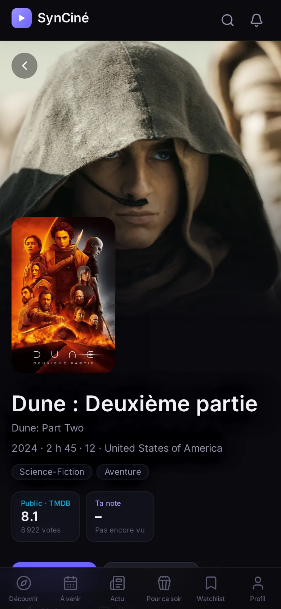
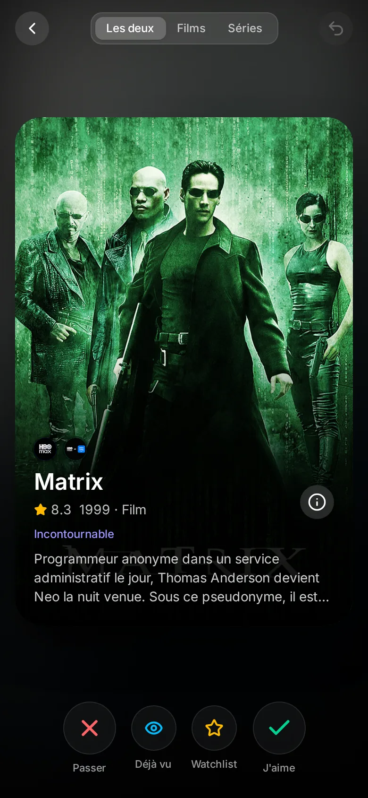

<p align="center">
  
</p>

<h1 align="center">SynCiné</h1>

<p align="center">
  <b>Your self-hosted film-lover's companion.</b><br />
  Streaming, local cinemas, watchlist and recommendations, together in one app.
</p>

<p align="center">
  <a href="README.md">Français</a> · <b>English</b>
</p>

<p align="center">
  
</p>

---

Discover, track and find all your films and series, **whatever streaming service they are on**, and never miss what's showing **at the cinemas in your town**.

SynCiné brings **Trakt**, **TMDB** and **JustWatch** streaming availability together and keeps them in sync, in a single interface with **recommendations made for you**. Optional extras: your **Letterboxd** diary, your **Plex** library and add requests through **Seerr**.

Two editions: **personal**, just for you, or **server**, with an administrator and **family accounts**. Once online, SynCiné installs as an **app** on phones, tablets and computers (PWA), in French or English.

## Support SynCiné

SynCiné is free, open source and ad-free. If you enjoy it, you can buy **the developer a coffee… and some kibble for Claude, his cat** 🐱☕

<a href="https://ko-fi.com/pierre_et_chat"></a>

## Contents

- [Preview](#preview)
- [Features](#features)
- [Data sources](#data-sources)
- [Installation](#installation)
- [Getting started](#getting-started)
- [HTTPS access and mobile app](#https-access-and-mobile-app)
- [Updates and backups](#updates-and-backups)
- [Settings](#settings)
- [Security](#security)
- [Development](#development)
- [Contributors](#contributors)
- [Credits and license](#credits-and-license)

## Preview

<table>
  <tr>
    <td width="50%"><br /><sub><b>Title page</b>: where to watch, ratings, trailer, cast, seasons.</sub></td>
    <td width="50%"><br /><sub><b>Your cinemas</b>: today's and this week's showtimes, original or dubbed.</sub></td>
  </tr>
  <tr>
    <td><br /><sub><b>Watchlist</b>: one list, kept in sync across Trakt, Plex and Letterboxd.</sub></td>
    <td><br /><sub><b>Tonight</b>: only what you can start right now.</sub></td>
  </tr>
  <tr>
    <td><br /><sub><b>Statistics</b>: per day, week, month or year.</sub></td>
    <td><br /><sub><b>Admin area</b> (server edition): Plex streams, accounts, requests.</sub></td>
  </tr>
</table>

<p align="center">
  
  &nbsp;
  
  &nbsp;
  
</p>

<p align="center"><sub>Screenshots come from a demo account. The interface is shown in French; it is also available in English.</sub></p>

## Features

**Discover**
- Trending titles, what's new on your services, films in cinemas, and personalised suggestions based on your taste, your ratings and Trakt recommendations.
- Daily charts per streaming service; "Like / Not interested / Watched" right on the posters.
- **Swipe mode** to sort dozens of titles quickly: seen it, want to see it, not interested.
- **Tonight**: a selection limited to what you can watch right now, filtered by length and mood.

**At the cinema**
- Showtimes at **your usual cinemas** (France, Germany, Spain, Turkey, Mexico), with a "films only" filter (no operas or concerts).
- Cinema and streaming releases in your country, as a grid or a calendar.
- Still in cinemas? SynCiné tells you, and can request it for the day it comes out digitally.

**Film News**
- The latest reviews, news and videos from your favourite sources in one feed: IndieWire, Variety, Letterboxd Journal, Little White Lies, Écran Large, AlloCiné…
- Add any website or YouTube channel by pasting its address. Articles open on the original site, where your account or subscription still works.

**Where to watch**
- For every title, the services it's on in your country: subscription, rent, buy. Your own subscriptions come first.
- A "Watch on…" button that opens the right page, and the app itself on phones where possible.
- Audience rating (TMDB) and, with a Plex account linked, IMDb and Rotten Tomatoes; trailer, cast, collection.

**Track**
- **Watchlist, watched titles, ratings and favourites** gathered from Trakt, Plex and Letterboxd, and synced both ways (with a preview and safeguards).
- Series tracking season by season, episode by episode.
- **Notifications**: a watchlist title lands on one of your services, a new episode of a show you follow is out, a service stops responding.
- Detailed **statistics** of your history: hours, films, episodes, genres, days and times you watch.

**For the family (server edition)**
- One administrator and an account for each member: everyone has their own watchlist, ratings, history and services.
- Sign in with a password, or with a Plex account the administrator has allowed.
- **Add requests**: sent straight to Seerr for allowed members, otherwise queued for the administrator.
- **Plex dashboard**: what's playing (bandwidth, transcoding), libraries and scans, server statistics.

**Everywhere**
- Installable app (PWA) on iPhone, iPad, Android and desktop, light or dark theme.
- Interface in **French** and **English**.

## Data sources

| Service | Used for | |
|---|---|---|
| [TMDB](https://www.themoviedb.org) | Title details, trending, releases, search, streaming availability | **Required** (free key) |
| [Trakt](https://trakt.tv) | Watchlist, history, ratings, recommendations | Recommended |
| [JustWatch](https://www.justwatch.com) | Direct links to each service, new arrivals, charts | Optional (unofficial API, can be turned off) |
| AlloCiné · Filmstarts · SensaCine · Beyazperde | Showtimes at your cinemas | Optional (unofficial source) |
| [Letterboxd](https://letterboxd.com) | Your film diary (public RSS feed) | Optional |
| Film websites and YouTube channels | Film News (public RSS feeds, chosen by each user) | Optional |
| [Plex](https://www.plex.tv) | Your library, playback, history, family accounts | Optional |
| [Seerr](https://github.com/seerr-team/seerr) | Requests to add titles to your library | Optional |

SynCiné never downloads anything. It can only pass a request on to Seerr, which handles it according to your settings.

## Installation

SynCiné runs in **a single Docker container** (interface and server) and keeps everything in a SQLite database.

### Pick an edition

| | **Server** edition | **Personal** edition |
|---|---|---|
| For | You and your family | Just you |
| Sign-in | Yes: password or Plex account | No |
| Accounts, requests, admin area | Yes | — |
| Where to use it | Local network, Tailscale, or the Internet behind an HTTPS proxy | Trusted networks only (local network, Tailscale) |
| Setting | `CINESYNC_MODE=server` | `CINESYNC_MODE=personal` |

### With Docker Compose

Requirements: Docker with the Compose plugin.

```bash
git clone https://github.com/GauffrePierre/syncine.git
cd syncine
cp .env.example .env     # then adjust: edition, data folder, port, PUBLIC_URL
docker compose up -d --build
```

The interface is then at `http://<server-address>:3000`.

In the server edition, the first screen creates the **administrator account**. It asks for a **setup code**, printed in the container logs:

```bash
docker logs cinesync 2>&1 | grep "code pour créer"
```

<details>
<summary>Use the published image instead of building</summary>

An image is published on GitHub with each release (x86 and ARM): `ghcr.io/gauffrepierre/syncine:latest`. In `docker-compose.yml`, remove the `build: .` line, then:

```bash
docker compose pull && docker compose up -d
```

</details>

### On Unraid

**With the Unraid template**: copy [`unraid/cinesync.xml`](unraid/cinesync.xml) to `/boot/config/plugins/dockerMan/templates-user/` on your Unraid flash drive. Then go to **Docker → Add Container** and pick **SynCiné** from the template list. Data goes to `/mnt/user/appdata/cinesync`, and the container runs as `nobody:users`.

<details>
<summary>With Docker Compose on Unraid (no plugin)</summary>

Unraid doesn't ship Docker Compose. The official binary can live next to the app, without installing anything on the system:

```bash
mkdir -p /mnt/user/appdata/cinesync/bin && cd /mnt/user/appdata/cinesync
V=v5.7.0; B=https://github.com/docker/compose/releases/download/$V
cd bin && curl -fLO $B/docker-compose-linux-x86_64 && curl -fLO $B/docker-compose-linux-x86_64.sha256 \
  && sha256sum -c docker-compose-linux-x86_64.sha256 && mv docker-compose-linux-x86_64 docker-compose && chmod +x docker-compose
cd .. && git clone https://github.com/GauffrePierre/syncine.git app && cd app
cp .env.example .env     # DATA_PATH=/mnt/user/appdata/cinesync/data, a free CINESYNC_PORT, PUBLIC_URL
../bin/docker-compose -p cinesync up -d --build
```

If port 3000 is already taken (Nginx Proxy Manager…), change `CINESYNC_PORT` in `.env`.

</details>

## Getting started

> 📘 **Step-by-step guides** for each situation: [personal edition](docs/guides/en/personal-edition.md) · [server, administrator](docs/guides/en/server-admin.md) · [family member, with or without Plex](docs/guides/en/server-member.md).

In short, everything is set up in **Profile**, in this order:

1. **TMDB**: create a free key at [themoviedb.org](https://www.themoviedb.org/settings/api) (Settings → API). Without it, SynCiné shows demo data.
2. **Region and services**: pick your country and tick your subscriptions. This drives badges, filters, the "Watch on…" button and notifications.
3. **Cinemas**: search for the cinemas you usually go to.
4. **Trakt**:
   1. Create an app at [trakt.tv](https://trakt.tv/oauth/applications/new). The redirect URI can stay `urn:ietf:wg:oauth:2.0:oob`.
   2. Enter its **Client ID**. No secret is needed.
   3. Click **Sign in with Trakt** and enter the code shown at trakt.tv/activate.
5. **Optional**:
   - **JustWatch**: one checkbox, for direct links and new arrivals.
   - **Letterboxd**: your username.
   - **Plex**: **Sign in with Plex**, then enter the code at plex.tv/link. SynCiné then finds the best connection to your server on its own.
   - **Seerr**: its address and API key.

**Automatic sync** (the same watchlist everywhere, watched titles and ratings copied where they're missing) is in Profile → Sync. A preview shows what will change before you turn it on.

<details>
<summary>Family accounts (server edition)</summary>

In **Profile → Admin settings** or the **Admin area**:

- **Local accounts**: you choose a username and a temporary password, which the person changes when they first sign in.
- **Plex accounts**: SynCiné lists the people your Plex server is shared with. Once allowed, they use "Sign in with Plex". SynCiné checks it really is that account, and everyone gets their own watched titles and progress.
- **Direct Seerr requests**: enabled per account. Otherwise requests land in the administrator's Requests tab, with a notification.

The TMDB key, Plex server, Seerr and JustWatch are set once by the administrator and shared by everyone. Trakt, Letterboxd, streaming services and cinemas are set per account.

</details>

## HTTPS access and mobile app

To install SynCiné as an app (PWA), browsers require **HTTPS**. Two options:

<details>
<summary><b>Tailscale</b>: private access, no open ports</summary>

With Tailscale installed on the server:

```bash
tailscale serve --bg --https=8443 http://127.0.0.1:3000
```

SynCiné is then at `https://<machine>.<tailnet>.ts.net:8443`, with a valid certificate, and only from your tailnet. In `.env`:

```ini
PUBLIC_URL=https://<machine>.<tailnet>.ts.net:8443
CINESYNC_BIND=127.0.0.1    # the HTTP port is no longer open on the network
```

On Unraid, avoid port 443: the Unraid web interface already uses it on the Tailscale address.

</details>

<details>
<summary><b>Your own domain</b>: behind a reverse proxy (Caddy, Nginx Proxy Manager, SWAG…)</summary>

Example with Caddy, which gets the certificate by itself:

```
cinesync.example.com {
    reverse_proxy 127.0.0.1:3000
}
```

In `.env`:

```ini
PUBLIC_URL=https://cinesync.example.com
CINESYNC_BIND=127.0.0.1
HSTS_SECONDS=31536000      # browsers will only use HTTPS for this domain
```

If the proxy runs in another container (Nginx Proxy Manager…), `127.0.0.1` can't be reached from it. Add a `docker-compose.override.yml`, specific to your server, to open SynCiné to the internal Docker network only:

```yaml
services:
  cinesync:
    ports:
      - "172.17.0.1:3000:8000"   # default Docker network gateway: not visible from your LAN
```

The proxy then forwards to `http://172.17.0.1:3000`. Its address must be in `FORWARDED_ALLOW_IPS`, which covers Docker networks by default. HSTS is only sent on the `PUBLIC_URL` domain.

</details>

**Installing the app:**
- **iPhone / iPad**: open SynCiné in Safari, then **Share → Add to Home Screen**.
- **Android**: Chrome offers to install it.
- **Desktop**: use the install icon in the address bar.

## Updates and backups

```bash
cd syncine && git pull && docker compose up -d --build
```

The database (`cinesync.db` in the data folder) is migrated automatically at startup.

**Backups**: SynCiné backs up its database every day into `backups/` (in the data folder) and keeps the last 7. In **Admin area → Backups** you can change that number, turn automatic backups off, back up right away or download a copy. A backup holds the tokens of your connected services: keep copies somewhere safe, ideally off the server too.

**Restore** a backup:

```bash
docker compose stop
gunzip -c data/backups/syncine-YYYYMMDD-HHMMSS.db.gz > data/cinesync.db
rm -f data/cinesync.db-wal data/cinesync.db-shm
docker compose start
```

## Settings

In the `.env` file (see [`.env.example`](.env.example)). Service keys are entered in the interface, not here.

| Variable | Default | Purpose |
|---|---|---|
| `CINESYNC_MODE` | `server` | `server` (accounts, sign-in) or `personal` (one person, no sign-in) |
| `DATA_PATH` | `./data` | Database folder on the host |
| `CINESYNC_PORT` | `3000` | Interface port on the host |
| `CINESYNC_BIND` | `0.0.0.0` | `127.0.0.1` to allow access only through an HTTPS proxy on the server |
| `PUBLIC_URL` | — | Public address (`https://…`): Trakt sign-in, secure cookies, origin check |
| `TZ` | `Europe/Paris` | Time zone |
| `PUID` / `PGID` | `99` / `100` | Owner of the data files |
| `HSTS_SECONDS` | `0` | Turns on HSTS (dedicated HTTPS-only domain) |
| `FORWARDED_ALLOW_IPS` | `127.0.0.1,172.16.0.0/12` | Proxies whose visitor address is trusted |
| `NOTIFICATION_INTERVAL_HOURS` | `24` | How often availability is checked |
| `API_DOCS` | `false` | Interactive API docs at `/api/docs` |
| `LOG_LEVEL` | `INFO` | Log level |

## Security

- **Server edition**:
  - sign-in is required, passwords are hashed (scrypt) and the session lives in an HttpOnly cookie;
  - optional two-factor authentication (6-digit codes from an app such as Aegis or Google Authenticator, recovery codes);
  - sign-in attempts are limited, and requests from other sites are refused;
  - every account only sees its own data.
- Service keys and tokens are never sent to the browser. The administrator only sees a masked preview.
- The container runs without root privileges, and the database is readable only by its owner.
- The **personal edition** has no sign-in: never expose it directly to the Internet.

To report a vulnerability, see [SECURITY.md](SECURITY.md).

## Development

> 🛠️ **Developer wiki**: [docs/wiki](docs/wiki/README.md) — architecture, backend, frontend, data, security, sync, testing, releases. For AI coding assistants: [AGENTS.md](AGENTS.md).

```bash
# Server (Python 3.12)
cd backend
python -m venv .venv && . .venv/bin/activate
pip install -r requirements.txt pytest
uvicorn app.main:app --reload --port 8000     # database in backend/data/
pytest

# Interface (Node 22)
cd frontend
npm install
npm run dev                                   # http://localhost:5173, /api proxied to :8000
```

<details>
<summary>Code layout</summary>

```
backend/app/
  main.py          FastAPI app: routes, security, built interface
  database.py      SQLite, migrations, per-account data scoping
  scheduler.py     periodic jobs (sync, availability, episodes, health)
  models/          accounts, settings, title state, history, notifications, requests
  routers/         API: auth, admin, media, library, tmdb, trakt, plex, cinema…
  services/        TMDB, Trakt, Plex, JustWatch, AlloCiné, Seerr, Letterboxd clients;
                   sync, history, suggestions, sessions
frontend/src/
  pages/           Discover, Upcoming, Tonight, Watchlist, title page, Profile, Statistics, Admin…
  components/      layout, posters, title page, admin, profile, swipe, notifications
  i18n/            translations (French text is the key, English dictionaries per area)
  hooks/ services/ store/
```

The code comments are in French.

</details>

## Contributors

- **Pierre Gauffre**: project creator and development.
- **Claude** ([Anthropic](https://www.anthropic.com)): development. Claude wrote much of the code and documentation, under Pierre's direction. Its contributions appear as co-author on the commits.

Contributions are welcome: report a bug or suggest an idea in the issues, or open a pull request.

## Credits and license

 &nbsp;This product uses the TMDB API but is not endorsed or certified by TMDB.

Streaming availability comes from [JustWatch](https://www.justwatch.com). Cinema showtimes come from Webedia's sites (AlloCiné, Filmstarts, SensaCine, Beyazperde). SynCiné is not affiliated with any of these services, nor with Trakt, Letterboxd, Plex or Seerr.

SynCiné is free software, released under the [GNU AGPL-3.0](LICENSE): you may use, study, modify and share it. Any modified version, including one offered as an online service, must remain free under the same license.
