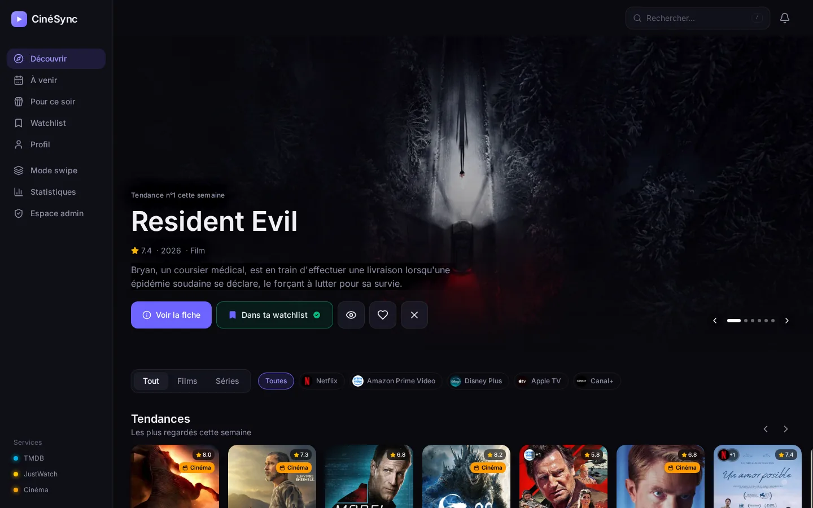
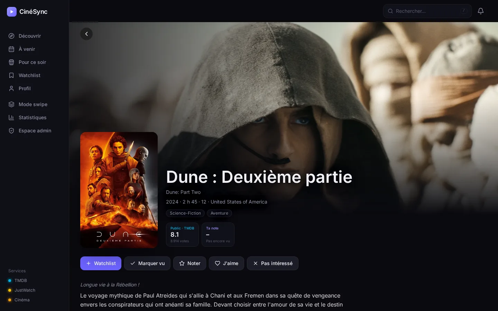
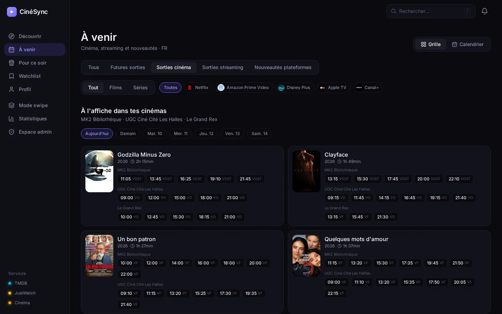
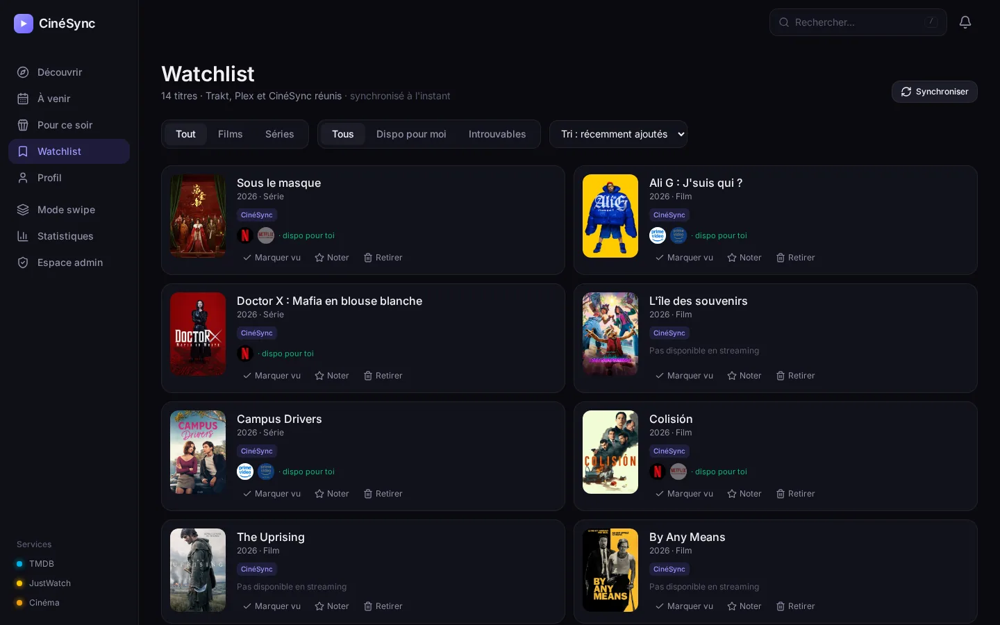
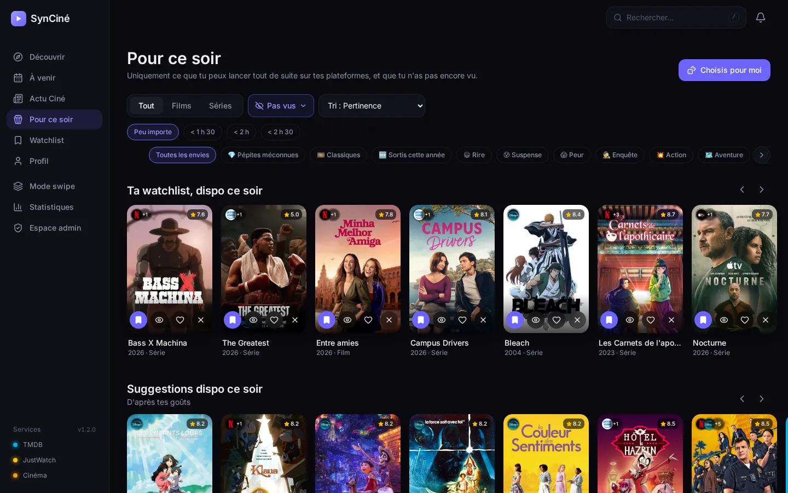
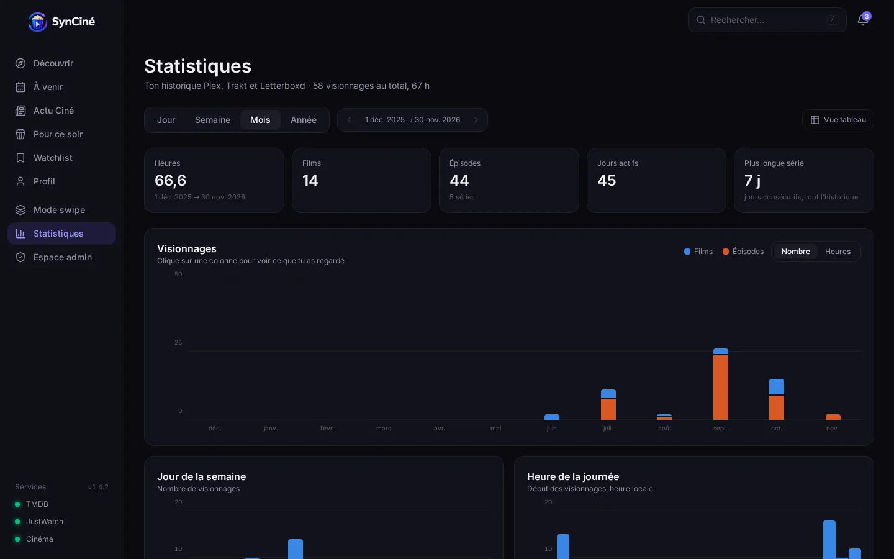
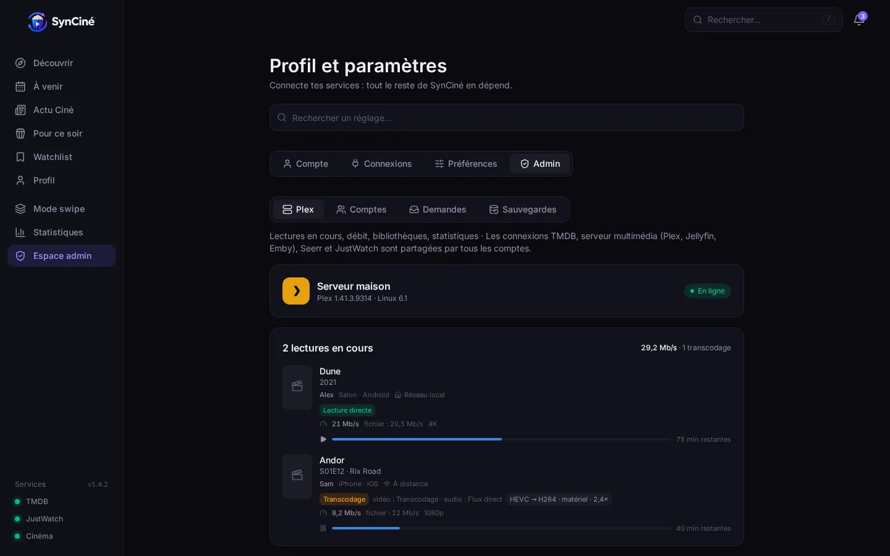
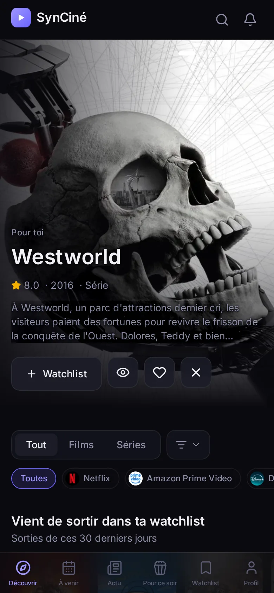
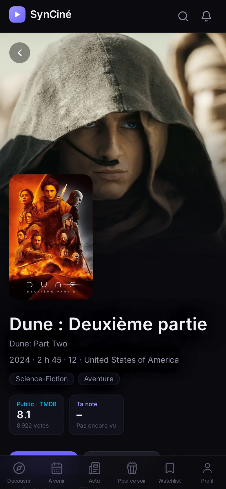
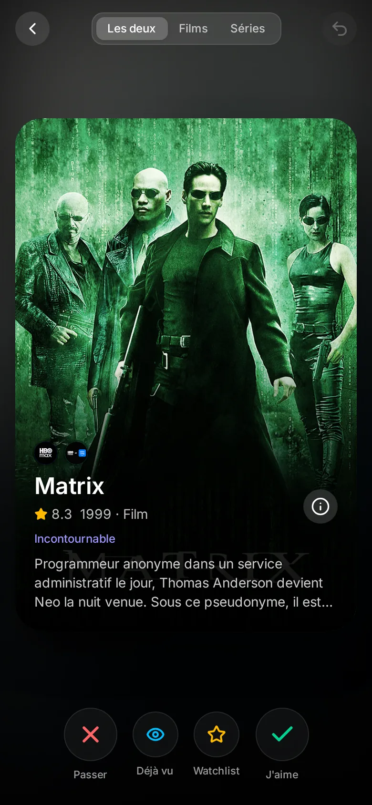

<p align="center">
  
</p>

<h1 align="center">CinéSync</h1>

<p align="center">
  <b>Ton compagnon de cinéphile, auto-hébergé.</b><br />
  Streaming, cinémas de quartier, watchlist et recommandations, réunis dans une seule appli.
</p>

<p align="center">
  <b>Français</b> · <a href="README.en.md">English</a>
</p>

<p align="center">
  
</p>

---

Découvre, suis et retrouve tous tes films et séries, **quelle que soit ta plateforme de streaming**, et ne rate plus rien de ce qui passe **dans les cinémas de ta ville**.

CinéSync réunit et synchronise **Trakt**, **TMDB** et les disponibilités streaming de **JustWatch** dans une seule interface, avec des **recommandations faites pour toi**. En option : ton journal **Letterboxd**, ta bibliothèque **Plex** et les demandes d'ajout via **Seerr**.

Deux versions : **personnelle**, pour toi seul, ou **serveur**, avec un administrateur et des **comptes pour la famille**. Une fois en ligne, CinéSync s'installe comme une **application** sur téléphone, tablette et ordinateur (PWA), en français ou en anglais.

## Soutenir CinéSync

CinéSync est gratuit, libre et sans publicité. Si l'appli te plaît, tu peux offrir **un café au développeur… et des croquettes à Claude, son chat** 🐱☕

<a href="https://ko-fi.com/pierre_et_chat"></a>

## Sommaire

- [Aperçu](#aperçu)
- [Fonctionnalités](#fonctionnalités)
- [Sources de données](#sources-de-données)
- [Installation](#installation)
- [Premiers pas](#premiers-pas)
- [Accès HTTPS et application mobile](#accès-https-et-application-mobile)
- [Mise à jour et sauvegarde](#mise-à-jour-et-sauvegarde)
- [Réglages](#réglages)
- [Sécurité](#sécurité)
- [Développement](#développement)
- [Contributeurs](#contributeurs)
- [Crédits et licence](#crédits-et-licence)

## Aperçu

<table>
  <tr>
    <td width="50%"><br /><sub><b>Fiche d'un titre</b> : où le regarder, notes, bande-annonce, casting, saisons.</sub></td>
    <td width="50%"><br /><sub><b>Tes cinémas</b> : les séances du jour et de la semaine, VO ou VF.</sub></td>
  </tr>
  <tr>
    <td><br /><sub><b>Watchlist</b> : une seule liste, synchronisée entre Trakt, Plex et Letterboxd.</sub></td>
    <td><br /><sub><b>Pour ce soir</b> : seulement ce que tu peux lancer tout de suite.</sub></td>
  </tr>
  <tr>
    <td><br /><sub><b>Statistiques</b> : par jour, semaine, mois ou année.</sub></td>
    <td><br /><sub><b>Espace admin</b> (version serveur) : lectures Plex en cours, comptes, demandes.</sub></td>
  </tr>
</table>

<p align="center">
  
  &nbsp;
  
  &nbsp;
  
</p>

<p align="center"><sub>Les captures viennent d'un compte de démonstration.</sub></p>

## Fonctionnalités

**Découvrir**
- Tendances, nouveautés sur tes plateformes, films à l'affiche et suggestions personnalisées, à partir de tes goûts, de tes notes et des recommandations Trakt.
- Classements du jour par plateforme, tuiles « J'aime / Pas intéressé / Vu » directement sur les affiches.
- **Mode swipe** pour trier rapidement des dizaines de titres : déjà vu, à voir, pas intéressé.
- **Pour ce soir** : une sélection limitée à ce que tu peux regarder tout de suite, filtrable par durée et par humeur.

**Au cinéma**
- Les séances de **tes salles habituelles** (France, Allemagne, Espagne, Turquie, Mexique), avec un filtre « films uniquement » (sans opéras ni concerts).
- Les sorties en salles et en streaming de ton pays, en grille ou en calendrier.
- Un film encore au cinéma ? CinéSync te le signale et peut demander son ajout pour le jour de sa sortie numérique.

**Actu Ciné**
- Les dernières critiques, actus et vidéos de tes sources préférées dans un seul fil : Écran Large, AlloCiné, Le Monde, Télérama, IndieWire, Variety, Letterboxd Journal…
- Ajoute n'importe quel site ou chaîne YouTube : il suffit de coller son adresse. Les articles s'ouvrent sur le site d'origine, où ton compte ou ton abonnement reste valable.

**Où regarder**
- Pour chaque titre, les plateformes où il est disponible dans ton pays : abonnement, location, achat. Tes abonnements passent en premier.
- Bouton « Regarder sur… » qui ouvre directement la bonne page, et l'application sur téléphone quand c'est possible.
- Notes du public (TMDB) et, avec un compte Plex relié, IMDb et Rotten Tomatoes ; bande-annonce, casting, collection.

**Suivre**
- **Watchlist, titres vus, notes et coups de cœur** réunis depuis Trakt, Plex et Letterboxd, et synchronisés dans les deux sens (avec aperçu et garde-fous).
- Suivi des séries saison par saison, épisode par épisode.
- **Notifications** : un titre de ta watchlist arrive sur une de tes plateformes, un nouvel épisode d'une série que tu suis est sorti, un service ne répond plus.
- **Statistiques** détaillées de ton historique : heures, films, épisodes, genres, jours et heures de visionnage.

**En famille (version serveur)**
- Un administrateur et des comptes pour chaque membre : chacun a sa watchlist, ses notes, son historique, ses services.
- Connexion par mot de passe, ou avec un compte Plex autorisé par l'administrateur.
- **Demandes d'ajout** : envoyées directement à Seerr pour les membres autorisés, sinon placées dans une file que l'administrateur traite.
- **Tableau de bord Plex** : lectures en cours (débit, transcodage), bibliothèques et analyses, statistiques du serveur.

**Partout**
- Application installable (PWA) sur iPhone, iPad, Android et ordinateur, thème clair ou sombre.
- Interface en **français** et en **anglais**.

## Sources de données

| Service | Rôle | |
|---|---|---|
| [TMDB](https://www.themoviedb.org) | Fiches, tendances, sorties, recherche, disponibilités streaming | **Indispensable** (clé gratuite) |
| [Trakt](https://trakt.tv) | Watchlist, historique, notes, recommandations | Recommandé |
| [JustWatch](https://www.justwatch.com) | Liens directs vers chaque plateforme, nouveautés, classements | Option (API non officielle, désactivable) |
| AlloCiné · Filmstarts · SensaCine · Beyazperde | Séances de tes cinémas | Option (source non officielle) |
| [Letterboxd](https://letterboxd.com) | Ton journal de films (flux RSS public) | Option |
| Sites de cinéma et chaînes YouTube | Actu Ciné (flux RSS publics, choisis par chacun) | Option |
| [Plex](https://www.plex.tv) | Ta bibliothèque, lecture, historique, comptes de la famille | Option |
| [Seerr](https://github.com/seerr-team/seerr) | Demandes d'ajout à ta bibliothèque | Option |

CinéSync ne télécharge rien. Il peut seulement transmettre une demande à Seerr, qui la traite ensuite selon tes réglages.

## Installation

CinéSync tient dans **un seul conteneur Docker** (interface et serveur) et stocke tout dans une base SQLite.

### Choisir une version

| | Version **serveur** | Version **personnelle** |
|---|---|---|
| Pour qui | Toi et ta famille | Toi seul |
| Connexion | Oui : mot de passe ou compte Plex | Non |
| Comptes, demandes, espace admin | Oui | — |
| Où l'utiliser | Réseau local, Tailscale, ou Internet derrière un proxy HTTPS | Réseau de confiance uniquement (réseau local, Tailscale) |
| Réglage | `CINESYNC_MODE=server` | `CINESYNC_MODE=personal` |

### Avec Docker Compose

Prérequis : Docker avec le plugin Compose.

```bash
git clone https://github.com/GauffrePierre/cinesync.git
cd cinesync
cp .env.example .env     # puis adapte : version, dossier des données, port, PUBLIC_URL
docker compose up -d --build
```

L'interface est ensuite sur `http://<adresse-du-serveur>:3000`.

En version serveur, le premier écran crée le **compte administrateur**. Il demande un **code d'installation**, affiché dans les journaux du conteneur :

```bash
docker logs cinesync 2>&1 | grep "code pour créer"
```

<details>
<summary>Utiliser l'image publiée au lieu de compiler</summary>

À chaque version, une image est publiée sur GitHub (PC et ARM) : `ghcr.io/gauffrepierre/cinesync:latest`. Dans `docker-compose.yml`, retire la ligne `build: .` puis :

```bash
docker compose pull && docker compose up -d
```

</details>

### Sur Unraid

**Avec le modèle Unraid** : copie [`unraid/cinesync.xml`](unraid/cinesync.xml) dans `/boot/config/plugins/dockerMan/templates-user/` sur ta clé Unraid. Va ensuite dans **Docker → Add Container** et choisis **CinéSync** dans la liste des modèles. Les données vont dans `/mnt/user/appdata/cinesync`, et le conteneur tourne sous `nobody:users`.

<details>
<summary>Avec Docker Compose sur Unraid (sans plugin)</summary>

Unraid n'embarque pas Docker Compose. Le binaire officiel peut être rangé avec l'application, sans rien installer dans le système :

```bash
mkdir -p /mnt/user/appdata/cinesync/bin && cd /mnt/user/appdata/cinesync
V=v5.7.0; B=https://github.com/docker/compose/releases/download/$V
cd bin && curl -fLO $B/docker-compose-linux-x86_64 && curl -fLO $B/docker-compose-linux-x86_64.sha256 \
  && sha256sum -c docker-compose-linux-x86_64.sha256 && mv docker-compose-linux-x86_64 docker-compose && chmod +x docker-compose
cd .. && git clone https://github.com/GauffrePierre/cinesync.git app && cd app
cp .env.example .env     # DATA_PATH=/mnt/user/appdata/cinesync/data, CINESYNC_PORT libre, PUBLIC_URL
../bin/docker-compose -p cinesync up -d --build
```

Si le port 3000 est déjà pris (Nginx Proxy Manager…), change `CINESYNC_PORT` dans `.env`.

</details>

## Premiers pas

> 📘 **Guides pas à pas** pour chaque situation : [version personnelle](docs/guides/fr/version-personnelle.md) · [serveur, administrateur](docs/guides/fr/serveur-admin.md) · [membre de la famille, avec ou sans Plex](docs/guides/fr/serveur-membre.md).

En résumé, tout se règle dans **Profil**, dans cet ordre :

1. **TMDB** : crée une clé gratuite sur [themoviedb.org](https://www.themoviedb.org/settings/api) (Paramètres → API). Sans elle, CinéSync affiche des données de démonstration.
2. **Région et plateformes** : choisis ton pays et coche tes abonnements. Ce choix sert aux badges, aux filtres, au bouton « Regarder sur… » et aux notifications.
3. **Cinémas** : cherche tes salles habituelles.
4. **Trakt** :
   1. Crée une application sur [trakt.tv](https://trakt.tv/oauth/applications/new). L'URL de retour peut rester `urn:ietf:wg:oauth:2.0:oob`.
   2. Saisis son **Client ID**. Aucun secret n'est nécessaire.
   3. Clique sur **Se connecter avec Trakt** et saisis le code affiché sur trakt.tv/activate.
5. **En option** :
   - **JustWatch** : une case à cocher, pour les liens directs et les nouveautés.
   - **Letterboxd** : ton nom d'utilisateur.
   - **Plex** : **Se connecter avec Plex**, puis le code à saisir sur plex.tv/link. CinéSync trouve ensuite tout seul la meilleure connexion à ton serveur.
   - **Seerr** : son adresse et sa clé API.

La **synchronisation automatique** (watchlist identique partout, vus et notes recopiés là où ils manquent) se règle dans Profil → Synchronisation. Un aperçu montre ce qui va changer avant de l'activer.

<details>
<summary>Comptes de la famille (version serveur)</summary>

Dans **Profil → Réglages admin** ou **Espace admin** :

- **Comptes locaux** : tu choisis un identifiant et un mot de passe provisoire, que la personne change à sa première connexion.
- **Comptes Plex** : CinéSync liste les personnes avec qui ton serveur Plex est partagé. Une fois autorisées, elles se connectent avec « Se connecter avec Plex ». CinéSync vérifie que c'est bien ce compte, et chacun retrouve ses propres vus et sa progression.
- **Demandes directes à Seerr** : à activer compte par compte. Sinon, les demandes arrivent dans l'onglet Demandes de l'administrateur, qui est prévenu par une notification.

Les clés TMDB, le serveur Plex, Seerr et JustWatch sont réglés une fois par l'administrateur et partagés par tous. Trakt, Letterboxd, les plateformes et les cinémas sont propres à chaque compte.

</details>

## Accès HTTPS et application mobile

Pour installer CinéSync comme une application (PWA), le navigateur exige le **HTTPS**. Deux solutions :

<details>
<summary><b>Tailscale</b> : accès privé, sans ouvrir de port</summary>

Avec Tailscale installé sur le serveur :

```bash
tailscale serve --bg --https=8443 http://127.0.0.1:3000
```

CinéSync est alors sur `https://<machine>.<tailnet>.ts.net:8443`, avec un certificat valide, et seulement depuis ton tailnet. Dans `.env` :

```ini
PUBLIC_URL=https://<machine>.<tailnet>.ts.net:8443
CINESYNC_BIND=127.0.0.1    # le port HTTP n'est plus ouvert sur le réseau
```

Sur Unraid, évite le port 443 : l'interface d'Unraid l'utilise déjà sur l'adresse Tailscale.

</details>

<details>
<summary><b>Nom de domaine</b> : derrière un proxy inverse (Caddy, Nginx Proxy Manager, SWAG…)</summary>

Exemple avec Caddy, qui obtient le certificat tout seul :

```
cinesync.exemple.fr {
    reverse_proxy 127.0.0.1:3000
}
```

Dans `.env` :

```ini
PUBLIC_URL=https://cinesync.exemple.fr
CINESYNC_BIND=127.0.0.1
HSTS_SECONDS=31536000      # le navigateur n'utilisera plus que le HTTPS pour ce domaine
```

Si le proxy tourne dans un autre conteneur (Nginx Proxy Manager…), `127.0.0.1` n'est pas joignable depuis ce conteneur. Ajoute un fichier `docker-compose.override.yml`, propre à ton serveur, pour ouvrir CinéSync au seul réseau interne de Docker :

```yaml
services:
  cinesync:
    ports:
      - "172.17.0.1:3000:8000"   # passerelle du réseau Docker par défaut : invisible du réseau local
```

Le proxy redirige alors vers `http://172.17.0.1:3000`. Son adresse doit faire partie de `FORWARDED_ALLOW_IPS`, ce qui est le cas par défaut pour les réseaux Docker. Le HSTS n'est envoyé que sur le domaine de `PUBLIC_URL`.

</details>

**Installer l'application :**
- **iPhone / iPad** : ouvre CinéSync dans Safari, puis **Partager → Sur l'écran d'accueil**.
- **Android** : Chrome propose directement l'installation.
- **Ordinateur** : utilise l'icône d'installation dans la barre d'adresse.

## Mise à jour et sauvegarde

```bash
cd cinesync && git pull && docker compose up -d --build
```

La base de données (`cinesync.db` dans le dossier des données) est migrée automatiquement au démarrage. Pour la sauvegarder sans arrêter CinéSync :

```bash
sqlite3 /chemin/des/donnees/cinesync.db ".backup cinesync-$(date +%F).db"
```

Elle contient les jetons de tes services connectés : garde ses sauvegardes en lieu sûr.

## Réglages

Dans le fichier `.env` (voir [`.env.example`](.env.example)). Les clés des services se saisissent dans l'interface, pas ici.

| Variable | Par défaut | Rôle |
|---|---|---|
| `CINESYNC_MODE` | `server` | `server` (comptes, connexion) ou `personal` (une personne, sans connexion) |
| `DATA_PATH` | `./data` | Dossier de la base sur l'hôte |
| `CINESYNC_PORT` | `3000` | Port de l'interface sur l'hôte |
| `CINESYNC_BIND` | `0.0.0.0` | `127.0.0.1` pour n'autoriser que l'accès par un proxy HTTPS installé sur le serveur |
| `PUBLIC_URL` | — | Adresse publique (`https://…`) : connexion Trakt, cookies sécurisés, vérification d'origine |
| `TZ` | `Europe/Paris` | Fuseau horaire |
| `PUID` / `PGID` | `99` / `100` | Propriétaire des fichiers de données |
| `HSTS_SECONDS` | `0` | Active le HSTS (domaine dédié en HTTPS uniquement) |
| `FORWARDED_ALLOW_IPS` | `127.0.0.1,172.16.0.0/12` | Proxys dont l'adresse du visiteur est acceptée |
| `NOTIFICATION_INTERVAL_HOURS` | `24` | Fréquence de vérification des disponibilités |
| `API_DOCS` | `false` | Documentation interactive de l'API sur `/api/docs` |
| `LOG_LEVEL` | `INFO` | Niveau des journaux |

## Sécurité

- **Version serveur** :
  - connexion obligatoire, avec des mots de passe hachés (scrypt) et une session dans un cookie HttpOnly ;
  - essais de connexion limités, requêtes venant d'autres sites refusées ;
  - chaque compte ne voit que ses propres données.
- Les clés et jetons des services ne sont jamais renvoyés au navigateur. L'administrateur en voit seulement un aperçu masqué.
- Le conteneur tourne sans les droits root, et la base n'est lisible que par son propriétaire.
- La **version personnelle** n'a pas de connexion : ne l'expose jamais directement sur Internet.

Pour signaler une faille, voir [SECURITY.md](SECURITY.md).

## Développement

> 🛠️ **Wiki développeur** (en anglais) : [docs/wiki](docs/wiki/README.md) — architecture, serveur, interface, données, sécurité, synchronisation, tests, publication. Pour les assistants de code IA : [AGENTS.md](AGENTS.md).

```bash
# Serveur (Python 3.12)
cd backend
python -m venv .venv && . .venv/bin/activate
pip install -r requirements.txt pytest
uvicorn app.main:app --reload --port 8000     # base dans backend/data/
pytest

# Interface (Node 22)
cd frontend
npm install
npm run dev                                   # http://localhost:5173, /api relayé vers :8000
```

<details>
<summary>Organisation du code</summary>

```
backend/app/
  main.py          application FastAPI : routes, sécurité, interface compilée
  database.py      SQLite, migrations, données cloisonnées par compte
  scheduler.py     tâches périodiques (synchronisation, disponibilités, épisodes, santé)
  models/          comptes, réglages, état des titres, historique, notifications, demandes
  routers/         API : auth, admin, media, library, tmdb, trakt, plex, cinema…
  services/        clients TMDB, Trakt, Plex, JustWatch, AlloCiné, Seerr, Letterboxd ;
                   synchronisation, historique, suggestions, sessions
frontend/src/
  pages/           Découvrir, À venir, Pour ce soir, Watchlist, fiche, Profil, Statistiques, Admin…
  components/      mise en page, affiches, fiche, admin, profil, swipe, notifications
  i18n/            traductions (le français sert de clé, dictionnaires anglais par zone)
  hooks/ services/ store/
```

</details>

## Contributeurs

- **Pierre Gauffre** : créateur du projet et développement.
- **Claude** ([Anthropic](https://www.anthropic.com)) : développement. Claude a écrit une grande partie du code et de la documentation, sous la direction de Pierre. Ses contributions apparaissent comme co-autrice des commits.

Les contributions sont les bienvenues : signale un bug ou propose une idée dans les *issues*, ou ouvre une *pull request*.

## Crédits et licence

 &nbsp;Ce produit utilise l'API TMDB, mais n'est ni approuvé ni certifié par TMDB.

Les disponibilités streaming proviennent de [JustWatch](https://www.justwatch.com). Les séances de cinéma proviennent des sites du groupe Webedia (AlloCiné, Filmstarts, SensaCine, Beyazperde). CinéSync n'est affilié à aucun de ces services, ni à Trakt, Letterboxd, Plex ou Seerr.

CinéSync est un logiciel libre, distribué sous licence [GNU AGPL-3.0](LICENSE) : tu peux l'utiliser, l'étudier, le modifier et le partager. Toute version modifiée, y compris proposée comme service en ligne, doit rester libre sous la même licence.
