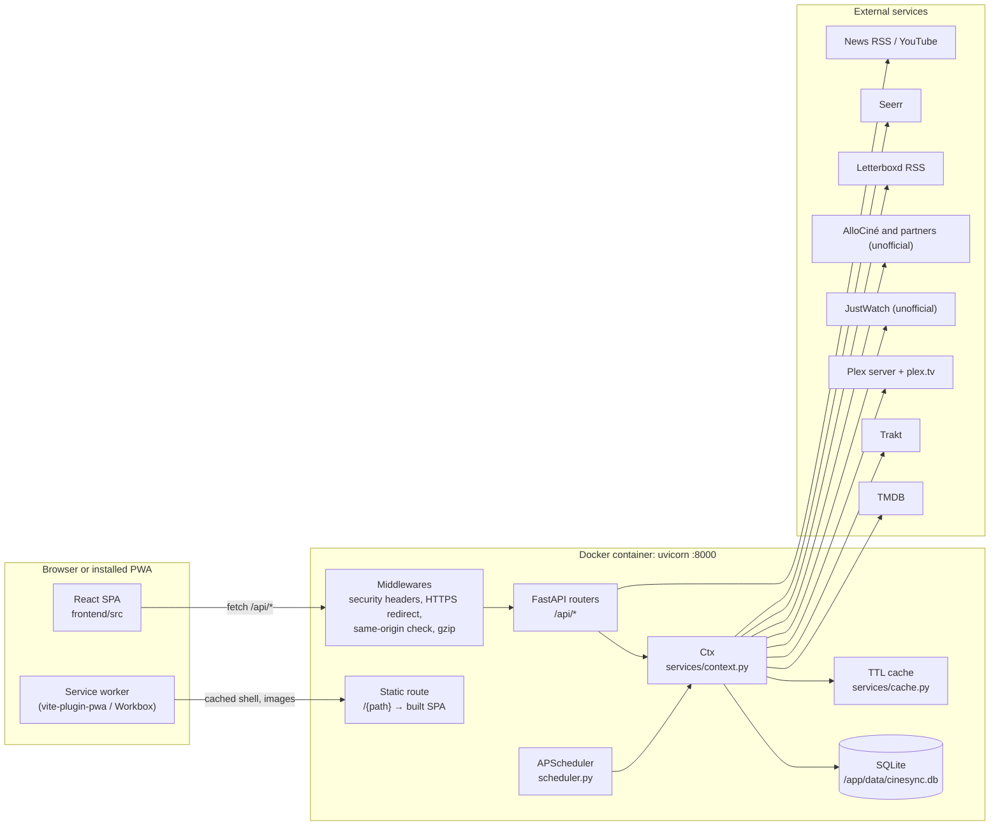

# Architecture

CinéSync runs as **one process in one container**. A FastAPI application (served by uvicorn on port 8000) exposes the JSON API under `/api` and also serves the compiled React app. All state lives in a single SQLite file, periodic work runs in an in-process APScheduler, and calls to external services go through a shared HTTP client with an in-memory TTL cache. The browser side is a PWA with a Workbox service worker.

## Components at a glance

## One container, two jobs

The root `Dockerfile` has two stages:

1. **`node:22-alpine`** runs `npm ci` and `npm run build` in `frontend/`, producing `dist/`.
2. **`python:3.12-slim`** installs `backend/requirements.txt`, copies `backend/app` to `/app/app` and the built frontend to `/app/static`.

At runtime, `backend/app/main.py` does both jobs:

- **API**: every router is mounted with `prefix="/api"`. `routers/auth.py` is public; all the others are mounted with `dependencies=[Depends(require_ready)]`, so they need a valid session (see [Accounts and security](06-accounts-and-security.md)). `GET /api/health` returns `{status, version, mode}` and is used by the Docker `HEALTHCHECK`.
- **SPA**: if `static/index.html` exists, a catch-all `GET /{path:path}` route serves files from `config.static_dir`. Unknown paths fall back to `index.html` (client-side routing), and paths starting with `api/` return a JSON 404. Cache headers:

| File | `Cache-Control` |
|---|---|
| `sw.js`, `manifest.json`, `index.html`, `registerSW.js` | `no-cache` |
| `assets/*` (hashed names) | `public, max-age=31536000, immutable` |
| anything else (icons…) | `public, max-age=86400` |

In development the `static/` folder is absent, so FastAPI only serves the API and Vite serves the frontend (see [Development setup](02-dev-setup.md)).

## Startup and shutdown

`main.py` uses a FastAPI `lifespan`:

1. `init_db()` (`database.py`) creates tables, runs the lightweight migrations and makes sure an admin account exists. If no admin can sign in yet, it prints a **setup code** in the logs.
2. `start_scheduler()` (`scheduler.py`) registers the periodic jobs.
3. On shutdown: `stop_scheduler()` and `close_http()` (closes the shared `httpx.AsyncClient` from `services/http.py`).

## SQLite

`database.py` creates the engine from `config.database_url` (`sqlite:///<data_dir>/cinesync.db`) and sets `PRAGMA journal_mode=WAL` and `PRAGMA foreign_keys=ON` on every connection. Personal data is scoped per user automatically; see [Data model](05-data-model.md).

## Scheduled jobs

`scheduler.py` uses an `AsyncIOScheduler`. Each job runs with `max_instances=1` and `coalesce=True`.

| Job id | Function | Interval | First run |
|---|---|---|---|
| `services_health` | `services/health.py: check_all` | 15 min | +20 s |
| `library_pull` | `pull_library` (sync + history import) | 30 min | +45 s |
| `watchlist_availability` | `check_watchlist_availability` | `NOTIFICATION_INTERVAL_HOURS` (default 24 h) | +5 min |
| `new_episodes` | `check_new_episodes` | 6 h | +3 min |

Personal jobs go through `for_each_user(job)`: for every active account (admins first, because the admin imports the server-wide Plex history), it opens a session, builds a `Ctx` with `ctx_for(db, user)` and runs the job. A failing account is logged and does not stop the others.

## In-memory TTL cache

`services/cache.py` defines `TTLCache` (max 5,000 entries) and a module-level `cache`. Keys are tuples whose **first element is the service name** (`"tmdb"`, `"trakt"`, `"plex"`…), so `cache.clear("trakt")` drops one service and `cache.clear()` drops everything. Clients pick a TTL per call (from 2 minutes for Seerr status to 7 days for TMDB genre lists). Per-account data is namespaced: Trakt keys include the account id, Plex keys include a hash of the token.

> Several pieces of state are in memory only: the cache, the login rate limiter, pending Plex PINs, service health and the last sync result. CinéSync is designed to run as **a single uvicorn worker**; do not scale it to several processes.

## Request context: `Ctx`

`services/context.py` defines `Ctx`, a small dataclass that every router receives through `get_ctx`. It holds the bound DB session, the user and their **effective settings**, and lazily builds service clients:

| Property | Returns |
|---|---|
| `ctx.tmdb` | `TMDBClient`, or `MockTMDB` when no key is set (demo data) |
| `ctx.trakt` / `ctx.trakt_app` | Connected Trakt client / client that only needs the app id |
| `ctx.plex` / `ctx.plex_own` / `ctx.plex_admin` | Plex server client for reads (the account's own token; admins fall back to the server token; `None` for members without Plex, who see nothing of the server) / the account's own token / the admin's token |
| `ctx.plex_account` | plex.tv account client (watchlist, ratings) |
| `ctx.seerr`, `ctx.letterboxd`, `ctx.justwatch` | Optional clients, `None` when not configured |

Properties return `None` when a service is not configured, so code reads naturally: `if ctx.trakt: ...`. More in [Backend](03-backend.md).

## PWA and service worker

- `frontend/vite.config.js` configures `vite-plugin-pwa` with `registerType: 'autoUpdate'`, `injectRegister: false` and `manifest: false` (the manifest is `frontend/public/manifest.json`).
- Workbox caches the app shell (navigation fallback to `/index.html`, never for `/api/`), TMDB images (`CacheFirst`, 30 days) and relayed Plex images from `/api/plex/image` (`CacheFirst`, 7 days).
- `frontend/src/main.jsx` registers the worker with `registerSW` and checks for a new version on open, every time the app becomes visible again, and every hour. With `autoUpdate`, the new version installs and reloads by itself.
- `frontend/public/theme-init.js` applies the saved theme before the first paint (a separate file, because the CSP forbids inline scripts).

## See also

- [Development setup](02-dev-setup.md)
- [Backend](03-backend.md)
- [Data model](05-data-model.md)
- [Accounts and security](06-accounts-and-security.md)
- [Integrations](08-integrations.md)
