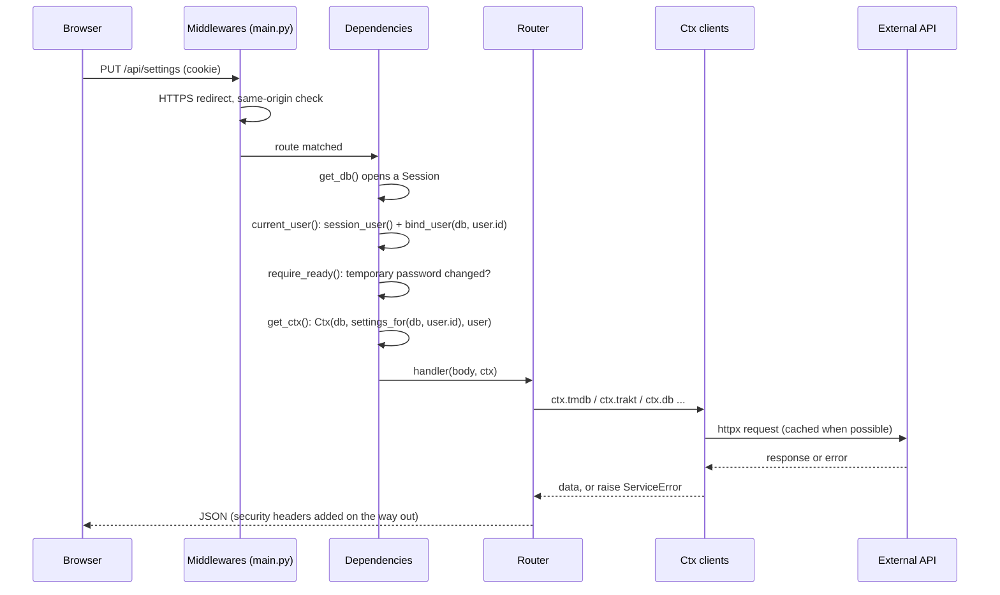

# Backend

The backend is a FastAPI application in `backend/app`. Routers stay thin: they declare endpoints, validate input with Pydantic and delegate to services, which talk to the database and to external APIs. Every authenticated request gets a `Ctx` object carrying the user, their settings, a user-scoped DB session and ready-to-use service clients. External failures are raised as `ServiceError` and turned into clean JSON errors.

## Layout of `backend/app`

| Path | Role |
|---|---|
| `__init__.py` | `__version__` (single source of the backend version) |
| `main.py` | App creation, middlewares, router mounting, `/api/health`, static SPA route |
| `config.py` | `Config` (pydantic-settings), the `config` singleton |
| `database.py` | Engine, `Base`, `UserScoped`, `bind_user`, `get_db`, migrations, `init_db`, setup code |
| `scheduler.py` | APScheduler jobs and `for_each_user` |
| `models/` | SQLAlchemy models (see [Data model](05-data-model.md)) |
| `schemas/` | Pydantic models: `settings.py` (`SettingsOut`, `SettingsUpdate`, `SECRET_FIELDS`), `media.py`, `swipe.py` |
| `routers/` | One module per API area |
| `services/` | Business logic and external clients |

### Routers

All are mounted under `/api` in `main.py`.

| Module | Prefix | Purpose |
|---|---|---|
| `auth.py` | `/auth` | Setup, login/logout, password, profile, Plex sign-in (public router) |
| `admin.py` | `/admin` | Accounts, allowed Plex / Jellyfin accounts, media server dashboards (Plex, Jellyfin / Emby), backups (admin only) |
| `user.py` | (none) | `/settings`, `/settings/status`, `/settings/test/{service}`, `/meta/*`, `/stats/*` |
| `library.py` | `/library` | Merged personal state, actions, sync, sync preview |
| `media.py` | `/media` | Aggregated title page, highlights, suggestions |
| `tmdb.py` | `/tmdb` | Trending, search, upcoming, details, providers, collections |
| `trakt.py` | `/trakt` | Trakt OAuth (device code, PKCE) and read endpoints |
| `plex.py` | `/plex` | Library, image relay, server linking (admin), watch links |
| `cinema.py` | `/cinema` | Cinema search and showtimes |
| `episodes.py` | `/episodes` | Per-episode series tracking |
| `requests.py` | `/requests` | Add requests (direct to Seerr or admin queue) |
| `seerr.py` | `/seerr` | Seerr status of a title |
| `justwatch.py` | `/justwatch` | Charts and new arrivals |
| `letterboxd.py` | `/letterboxd` | Diary |
| `news.py` | `/news` | Film News feed, sources, signed image relay |
| `notifications.py` | `/notifications` | Bell notifications |
| `search.py` | (none) | `/search`, global search |
| `swipe.py` | `/swipe` | Swipe queue, actions, undo, history |
| `tonight.py` | `/tonight` | "Tonight" selection |

### Services

| Module | Role |
|---|---|
| `context.py` | `Ctx`, `get_ctx`, `ctx_for`, `EffectiveSettings`, `GLOBAL_FIELDS`, `public_base_url` |
| `auth.py` | Passwords, sessions, `RateLimiter`, `current_user`, `require_ready`, `require_admin`, `require_server_mode` |
| `errors.py` | `ServiceError`, `NotConfigured` |
| `cache.py` | `TTLCache` and the shared `cache` |
| `http.py` | Shared `httpx.AsyncClient` (`http()`), `close_http()` |
| `library_sync.py` | Pull, actions and two-way sync ([Sync engine](07-sync-engine.md)) |
| `history.py` | Watch history import and statistics |
| `enrich.py` | Adds streaming providers and Plex presence to lists |
| `suggestions.py` | Suggestions from swipes, Trakt and TMDB recommendations |
| `health.py` | Connection tests, service health, outage notifications |
| `safe_fetch.py` | SSRF-safe fetching of user-supplied URLs |
| `secret.py` | Server secret (`data/secret.key`) |
| `mock_data.py` | `MockTMDB`, `MockTrakt`, `MockPlex` demo data |
| `*_client.py`, `plex_auth.py`, `plex_account.py`, `news.py` | External services ([Integrations](08-integrations.md)) |

## How a request flows



Key points:

- `get_db` is used by both `current_user` and `get_ctx`. FastAPI caches dependencies per request, so they share **the same session**, which `current_user` has already bound to the user. Every ORM query on `ctx.db` is therefore filtered to that user (see [Data model](05-data-model.md)).
- `settings_for(db, user_id)` returns an `EffectiveSettings`: fields in `GLOBAL_FIELDS` (TMDB key, Plex server, Seerr, JustWatch, Trakt app, YouTube key) are read from and written to the shared row `id=1`; everything else goes to the user's own row.
- Background jobs build the same context with `ctx_for(db, user)` (`services/context.py`).

## Error handling

`services/errors.py` defines two exceptions:

```python
class ServiceError(Exception):
    def __init__(self, service: str, message: str, status: int = 502): ...

class NotConfigured(ServiceError):  # status 409, message "… — voir la page Profil"
```

- `main.py` registers a handler that turns `ServiceError` into `{"detail": message, "service": service}` with `exc.status`.
- Clients convert transport errors and HTTP status codes into `ServiceError` with a French message (for example `"Clé API TMDB invalide"`, status 401).
- For input or permission problems, routers raise FastAPI's `HTTPException(status, "French message")`.
- Aggregating endpoints wrap optional calls in a small `safe()` helper so one failing service does not break the page (see `routers/media.py: full_detail`, `routers/user.py: stats`).
- The frontend translates `detail` client-side (see [Internationalisation](09-i18n.md)).

## Adding an endpoint, step by step

Say you want `GET /api/letterboxd/stats`.

1. **Pick or create a router** in `backend/app/routers/`. A new module looks like:

   ```python
   from fastapi import APIRouter, Depends
   from app.services.context import Ctx, get_ctx
   from app.services.errors import NotConfigured

   router = APIRouter(prefix="/letterboxd", tags=["letterboxd"])

   @router.get("/stats")
   async def stats(ctx: Ctx = Depends(get_ctx)):
       if not ctx.letterboxd:
           raise NotConfigured("letterboxd")
       diary = await ctx.letterboxd.diary()
       return {"entries": len(diary)}
   ```

2. **Register a new module** in `main.py`: import it and add it to the tuple in the `for r in (...)` loop. It then gets the `/api` prefix and `require_ready` automatically. Only `auth.router` is mounted without it.
3. **Admin only?** Add `dependencies=[Depends(require_admin)]` to the route (or the router, like `admin.py`). Server edition only? Add `Depends(require_server_mode)`.
4. **Put logic in a service** if it is more than a few lines, or if the scheduler also needs it. Services take a `Ctx`.
5. **Use `ctx.db` for personal data.** Queries are scoped automatically. Reading every account's rows needs `.execution_options(all_users=True)`; do that only in admin or global code.
6. **Validate input** with a Pydantic model (`Field(max_length=…)`, `Literal[...]`), and return plain dicts.
7. **Write the frontend side**: a function in `frontend/src/services/`, a hook with a query key (see [Frontend](04-frontend.md)).
8. **Translate new messages**: any French `detail` you raise must have an English entry in `frontend/src/i18n/en/*.js`.
9. **Test it** in `backend/tests/` (see [Testing](10-testing.md)).

## Conventions

- **French comments and docstrings** in the code. This is the existing convention; keep it consistent within a file.
- **French user-facing messages** from the server (`HTTPException` details, `ServiceError` messages, notifications). They are translated on the client.
- Type hints on function signatures; small, focused functions; module docstring explaining the "why".
- Async for anything that does I/O to external services; use `asyncio.gather` for independent calls and a `Semaphore` to limit concurrency.
- Never return secrets: settings go out through `SettingsOut.from_model`, which masks `SECRET_FIELDS`.
- All outbound HTTP goes through `services/http.py: http()` (shared pool, timeouts, user agent), except user-supplied URLs, which must use `services/safe_fetch.py`.

## See also

- [Architecture](01-architecture.md)
- [Data model](05-data-model.md)
- [Accounts and security](06-accounts-and-security.md)
- [Integrations](08-integrations.md)
- [Testing](10-testing.md)
