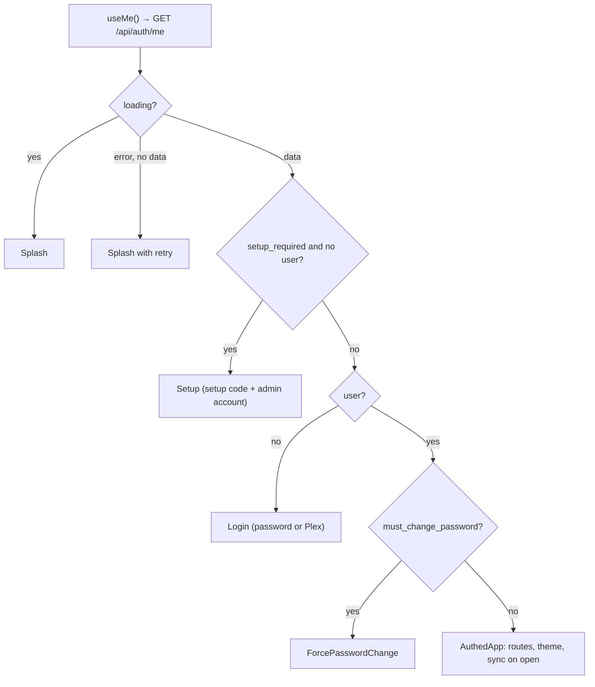

# Frontend

The frontend is a React 18 single-page app in `frontend/src`, built with Vite and styled with Tailwind CSS v4. Server data is fetched with TanStack Query through small service modules, client-only state lives in two Zustand stores, and routing uses React Router v7. `App.jsx` acts as an auth gate: it decides between setup, login, forced password change and the app itself.

## Layout of `frontend/src`

| Path | Contents |
|---|---|
| `main.jsx` | Entry: `QueryClient`, `BrowserRouter`, fonts, CSS, service worker registration |
| `App.jsx` | Auth gate and routes |
| `index.css` | Tailwind import, design tokens, light/dark themes |
| `pages/` | One component per route: `Discover`, `Upcoming`, `News`, `Library` (Plex), `Tonight`, `Watchlist`, `MediaDetail`, `Profile` (tabs `?tab=account|connections|prefs|admin`; the admin tab has `&section=server|users|requests|backups`), `Stats`, `Admin` (redirects the old /admin address), `Swipe`, `Login` (also exports `Setup`, `ForcePasswordChange`, `Splash`) |
| `components/` | `layout/`, `media/` (+ `media/detail/`), `profile/`, `admin/`, `swipe/`, `notifications/`, `search/`, `stats/`, `upcoming/`, `ui/` |
| `hooks/` | `useAuth.js`, `useMedia.js` (most data hooks), `useSyncOnOpen.js`, `useTheme.js`, `useDebounce.js`, `useSwipeGesture.js` |
| `services/` | `api.js` (fetch wrapper) and one module per API area: `auth`, `admin`, `library`, `tmdb` (also `media`, `justwatch`), `trakt`, `plex`, `user`, `requests`, `search`, `swipe`, `news`, `notifications` |
| `store/` | Zustand: `settingsStore.js`, `uiStore.js` |
| `lib/` | `appLinks.js`, `format.js` (dates, runtimes, `detailPath`), `platforms.js` (platform colors), `project.js` (repository links) |
| `i18n/` | Translation engine and English dictionaries ([Internationalisation](09-i18n.md)) |

## Talking to the API

`services/api.js` wraps `fetch`:

- Every path is prefixed with `/api`; JSON in, JSON out; the session cookie is sent by the browser.
- On error it throws `ApiError(message, status, service)`. The message is the server's French `detail`, **translated** with `t()`.
- A `401` outside `/auth/*` dispatches a `cinesync:unauthorized` window event, which sends the user back to the login screen.
- `qs(params)` builds a query string and skips empty values.

Service modules are plain objects of functions, for example `library.addToWatchlist(mediaType, id, title)` in `services/library.js`.

## TanStack Query

The `QueryClient` in `main.jsx` sets: `staleTime` 5 min, no refetch on window focus, and at most one retry (never for 4xx errors). Hooks live mostly in `hooks/useMedia.js`, one per page need. Common query keys:

| Key | Data |
|---|---|
| `['me']` | Current account, edition, setup state (`useMe` in `hooks/useAuth.js`) |
| `['settings']`, `['status']` | Settings and connection status (status refetches every 2 min) |
| `['library-keys']` | Compact personal state used by every poster button |
| `['watchlist', mediaType, availability, sort]` | Infinite watchlist |
| `['media', mediaType, id]` | Aggregated title page |
| `['suggestions', mediaType]`, `['trending', mediaType]`, `['highlights']` | Discover |
| `['upcoming', mediaType, kind]`, `['showtimes', date]` | Upcoming and cinemas |
| `['library', mediaType, sort, q]` | Plex library |
| `['notifications']`, `['sync-status']`, `['news', kind]`, `['stats-activity', period, offset]` | Other pages |
| `['admin', ...]` | Admin area |

Patterns worth knowing:

- **Optimistic actions**: `useLibraryAction` (in `useMedia.js`) patches `['library-keys']` in `onMutate`, rolls back on error, shows a toast listing which services accepted the action, and invalidates related keys on settle.
- **Settings change**: `useUpdateSettings` writes the new settings into `['settings']` and invalidates everything else, since settings affect almost all data.
- **Account switch**: `useResetSession` removes every query except `['me']` after login or logout.
- **Sync on open**: `useSyncOnOpen` calls `POST /api/library/sync?max_age=120` at startup and when the app comes back after 5 minutes hidden, then invalidates the main keys.

## Zustand stores

| Store | Persisted as | Holds |
|---|---|---|
| `useSettingsStore` (`store/settingsStore.js`) | `cinesync-settings` | `theme`, `uiLanguage`: a local copy so the theme and language apply before the API answers. The backend settings stay the source of truth (`useTheme` syncs them). |
| `useUiStore` (`store/uiStore.js`) | `cinesync-ui` (filters only) | Media and platform filters, upcoming view, swipe filter; plus ephemeral `searchOpen` and `toasts` |

`toast(message, kind)` from `uiStore.js` can be called anywhere, including outside components.

## The auth gate in `App.jsx`



`AuthedApp` declares the routes. Everything except `/swipe` is nested in `AppLayout` (sidebar, top bar, bottom bar, search overlay, toasts, app chooser). `/swipe` is full screen. Unknown paths redirect to `/`.

## Navigation

`components/layout/nav.js` exports `NAV_ITEMS` and `useNavItems()`:

```js
{ to: '/library', label: 'Bibliothèque', icon: Library, needs: 'plex' }
```

- `label` is the French key, translated with `t(label)` by `Sidebar.jsx` and `BottomBar.jsx`; `short` is an optional shorter label for the bottom bar.
- `icon` comes from `lucide-react`.
- `needs` hides the item until that service is configured (checked against `useStatus()`).

## Styling

Tailwind v4 is loaded with `@import 'tailwindcss'` in `index.css` and the `@tailwindcss/vite` plugin; there is no `tailwind.config.js`.

- Design tokens are CSS variables on `:root` (`--bg`, `--bg2`, `--bg3`, `--text`, `--text2`, `--text3`, `--accent`, `--border`, platform colors like `--netflix`, `--plex`, chart colors `--series-1`, `--series-2`).
- `@theme inline` maps them to Tailwind colors, so you write `bg-bg2`, `text-text2`, `border-line`, `text-accent`.
- Dark is the default. Light comes from `prefers-color-scheme: light` unless `<html data-theme="dark">`, or is forced by `data-theme="light"`. `hooks/useTheme.js` sets `data-theme` from the settings.
- Fonts are self-hosted with `@fontsource/inter` (no Google Fonts request). Animations use `motion`.

## PWA registration

`main.jsx` imports `registerSW` from `virtual:pwa-register` and calls it with `immediate: true`. In `onRegisteredSW` it checks for updates every hour and whenever the document becomes visible. See [Architecture](01-architecture.md#pwa-and-service-worker) for the caching rules.

## Opening native apps: `WatchLink` and `lib/appLinks.js`

`components/ui/WatchLink.jsx` puts the app link directly in `href` when it is known (`directAppLink`), because iOS and Android only open another app from a real tap on a link, never from a JavaScript redirect. Otherwise it renders the web link and, on click, calls `openInApp(href, appRef)`, which can open `components/ui/AppChooser.jsx` ("app or browser").

The Plex app only opens a title's page from its **`watch.plex.tv`** link (`/movie/<slug>`, `/show/<slug>`: the paths Plex declares in `watch.plex.tv/.well-known/apple-app-site-association` and `assetlinks.json`). `plex://` links only open the app's home screen. Episode links fall back to the show page. The user then picks their server in the app. The link comes from `plex.watch_url` in the detail payload, or from `GET /api/plex/watch-link/...` in the chooser.

| Device (`device()`) | Behaviour |
|---|---|
| Android | `intent://` URL for known apps (`ANDROID_APPS`; Plex: the `watch.plex.tv` link with package `com.plexapp.android`) with `browser_fallback_url`, so Chrome falls back to the website. Plex without a known `watch_url` goes through the chooser |
| iOS / iPadOS | For Plex and Netflix, the chooser offers "app or browser" and can remember the choice (`localStorage` key `cinesync-open-in-app`); once remembered, the app link goes straight into `href`. Netflix uses `nflx://` |
| Desktop | Plain web link |

## Adding a page, step by step

1. **Backend first**, if needed (see [Backend](03-backend.md#adding-an-endpoint-step-by-step)).
2. **Service**: add a function to a module in `services/` (or a new module) using `api.get/post/put/patch/del`.
3. **Hook**: add a `useQuery` hook in `hooks/useMedia.js` (or locally in the page) with a clear query key. Invalidate it from the mutations that change it.
4. **Page**: create `pages/MyPage.jsx`. Use `const t = useT()` for every visible string, existing `components/ui/*` (`Button`, `Tabs`, `EmptyState`, `Skeleton`…) and token classes.
5. **Route**: add `<Route path="my-page" element={<MyPage />} />` inside the `AppLayout` route in `App.jsx`.
6. **Navigation** (optional): add an entry to `NAV_ITEMS` in `components/layout/nav.js`.
7. **Translations**: add every new French string to the right `i18n/en/*.js` dictionary.
8. **Check** with `npm run build`, and on a phone-sized window.

## See also

- [Architecture](01-architecture.md)
- [Backend](03-backend.md)
- [Internationalisation](09-i18n.md)
- [Testing](10-testing.md)
