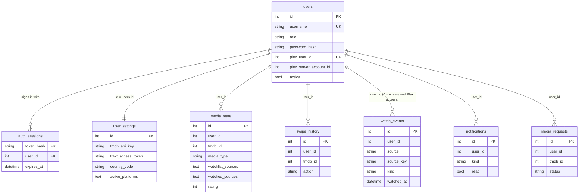
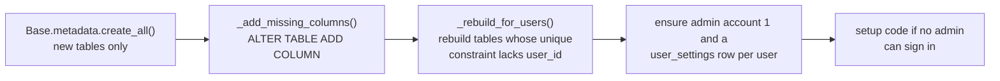

# Data model

All data lives in one SQLite file, `cinesync.db`, in the data folder. The models are SQLAlchemy 2.0 declarative classes in `backend/app/models`. Personal tables inherit a `UserScoped` mixin, and a session event filters every ORM query to the signed-in user automatically, so a router cannot leak another account's rows by forgetting a `WHERE`. Schema changes are applied at startup by two small migration helpers instead of a migration framework.

## Tables

| Model (file) | Table | Scoped | Purpose |
|---|---|---|---|
| `User` (`user.py`) | `users` | no | Accounts: `username`, `role` (`admin`/`member`), `password_hash`, `must_change_password`, Plex link (`plex_user_id`, `plex_server_account_id`…), `can_request_direct`, `active` |
| `AuthSession` (`user.py`) | `auth_sessions` | no | Sign-in sessions. Primary key is the SHA-256 `token_hash`; `user_id` is a foreign key with `ON DELETE CASCADE` |
| `UserSettings` (`user_settings.py`) | `user_settings` | no | One row per account, `id` = account id. Service keys and tokens, region, platforms, cinemas, notifications, theme, UI language, news sources |
| `MediaState` (`media_state.py`) | `media_state` | yes | Merged personal state of a title: watchlist/watched sources, rating, like/dislike, dates, cached providers |
| `SwipeHistory` (`swipe_history.py`) | `swipe_history` | yes | Swipe decisions (`skip`, `seen`, `watchlist`, `like`), so a title is never proposed twice |
| `WatchEvent` (`watch_event.py`) | `watch_events` | yes | One dated viewing (movie or episode) from Plex, Trakt or Letterboxd, for statistics |
| `Notification` (`notification.py`) | `notifications` | yes | Bell alerts; `kind` is `availability`, `episode`, `service` or `request` |
| `MediaRequest` (`media_request.py`) | `media_requests` | yes | Add requests: `pending`, `sent`, `declined`, `available` |



Only `auth_sessions` has a real foreign key; the other `user_id` columns are logical links managed by the application (for example `routers/admin.py: delete_user` deletes a member's scoped rows explicitly).

Unique constraints worth knowing: `media_state (user_id, tmdb_id, media_type)`, `swipe_history (user_id, tmdb_id, media_type)`, `watch_events (user_id, source, source_key)`.

## `media_state` in a nutshell

A title is identified by `(tmdb_id, media_type)` with `media_type` in `movie` / `tv`. Where the information came from is stored as JSON lists of sources: `"trakt"`, `"plex"`, `"letterboxd"`, `"local"` (done in CinéSync). Helpers on the model: `sources(field)`, `add_source`, `remove_source`, and properties `in_watchlist`, `watched`. `state()` and `to_item()` build the JSON sent to the frontend. Ratings are stored **out of 10** (the UI uses 1 to 5 stars, multiplied by 2). See [Sync engine](07-sync-engine.md).

## Shared vs per-user settings

Every account has its own `user_settings` row, but some fields describe the **server** and are shared by the family. `GLOBAL_FIELDS` in `services/context.py` lists them:

```
tmdb_api_key, plex_url, plex_server_name, plex_machine_id, plex_client_id,
seerr_url, seerr_api_key, justwatch_enabled, trakt_client_id, trakt_client_secret, youtube_api_key
```

`EffectiveSettings` routes reads and writes: a global field goes to the shared row (`SHARED_ID = 1`, the main admin), anything else to the account's own row. Its `.own` and `.shared` properties give direct access when needed (for example, `plex_token` exists on both: the admin's server token on the shared row and a member's own server token on theirs). Only admins may change `ADMIN_FIELDS` (`GLOBAL_FIELDS | {"plex_token"}`, in `routers/user.py`).

## Automatic per-user scoping

`database.py` implements it with three pieces:

```python
class UserScoped:
    user_id: Mapped[int] = mapped_column(Integer, index=True, default=1)

def bind_user(db: Session, user_id: int | None) -> Session:
    db.info["user_id"] = user_id
    return db
```

1. **`bind_user`** stores the user id in `session.info`. `services/auth.py: current_user` calls it for each request; `ctx_for` does it for scheduled jobs.
2. **`do_orm_execute` listener (`_scope_to_user`)**: when the session is bound and the statement is a SELECT (not a column or relationship lazy load), UPDATE or DELETE, it adds `with_loader_criteria(UserScoped, lambda cls: cls.user_id == uid, include_aliases=True)`. Every scoped model is filtered, including in joins.
3. **`before_flush` listener (`_assign_user`)**: new `UserScoped` objects without a `user_id` get the bound user. If the session is not bound, it raises `RuntimeError`, so personal rows can never be created "for nobody".

To deliberately read or write across accounts (admin pages, server-wide Plex history, request deduplication), opt out per statement:

```python
select(WatchEvent).where(...).execution_options(all_users=True)
```

Rules of thumb:

- In a router, always use `ctx.db`; never open your own `SessionLocal()` for personal data.
- Use `all_users=True` only in admin or global code, and double-check what is returned to the client (see `routers/requests.py: visible`).
- `watch_events.user_id = 0` holds Plex viewings of server accounts that are not (yet) linked to a CinéSync account. `services/history.py: assign_plex_events` hands them over when the admin allows that Plex account.

## Lightweight migrations

`init_db()` runs at every startup:



- **`_add_missing_columns()`**: `create_all()` never alters existing tables, so this compares each model with the live table and adds missing columns, with a `DEFAULT` literal when the column has a scalar default. That is why **new columns must be nullable or have a scalar default**.
- **`_rebuild_for_users()`**: SQLite cannot change a constraint. For tables in `_REBUILD_FOR_USERS` (`media_state`, `swipe_history`, `watch_events`) whose unique constraint does not include `user_id`, it renames the table, drops its indexes, recreates it from the model, copies the data (with `COALESCE(..., CURRENT_TIMESTAMP)` for server-default dates) and drops the old one. Existing rows go to account 1.
- Databases from before accounts: Plex viewings by other server accounts (`plex_account_id != 1`) are set to `user_id = 0`.

### Changing the schema

- **Add a column**: add it to the model, nullable or with a scalar `default=`. It appears at next startup.
- **New personal table**: inherit `UserScoped, Base` (in that order), include `user_id` in any unique constraint, and import it in `models/__init__.py`.
- **Rename, drop or change a type**: not handled automatically. Write an explicit, idempotent step in `init_db()` and test it against an old database (see `tests/test_accounts.py: test_single_user_database_is_migrated_to_admin`).

## See also

- [Backend](03-backend.md)
- [Accounts and security](06-accounts-and-security.md)
- [Sync engine](07-sync-engine.md)
- [Testing](10-testing.md)
