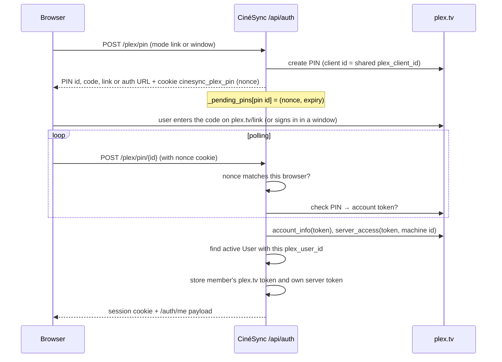

# Accounts and security

CinéSync holds tokens for several personal accounts, so security is built into the core rather than bolted on. This page explains the two editions, how the first admin is created, how sessions, passwords and login throttling work, the Plex sign-in flow, admin vs member permissions, and the HTTP-level protections (same-origin check, CSP, HTTPS redirect, HSTS). It also covers SSRF-safe fetching and the signed image relay. To report a vulnerability, follow [SECURITY.md](../../SECURITY.md).

## Editions

`CINESYNC_MODE` (`config.cinesync_mode`) selects the edition.

| | `server` (default) | `personal` |
|---|---|---|
| Who | An admin and family accounts | One person |
| Sign-in | Always required | None, unless the owner sets a password in Profile |
| How `session_user()` resolves | From the session cookie | Returns user 1 directly if it has no password, else like `server` |
| Multi-account endpoints | Available | `require_server_mode` answers 409 (setup, Plex sign-in, creating accounts, allowing Plex accounts) |

The personal edition must stay on a trusted network (LAN, Tailscale).

## First start: the setup code

On startup, `database.init_db()` checks `setup_required()`: true in `server` mode when no active admin has a password or a linked Plex account. It then generates a code such as `ABCD-1234-EF56` (`secrets.token_hex`), keeps it in `database.setup_code` and logs it. `POST /api/auth/setup` (`routers/auth.py`) compares it with `hmac.compare_digest`, is rate limited, and turns account 1 into the admin with the chosen username and password. The code is cleared once used.

## Passwords

In `services/auth.py`:

- **scrypt** from `hashlib` (`n=2**14, r=8, p=1`, 16-byte random salt, 32-byte key), stored as `scrypt$n$r$p$salt$hash` (base64).
- Verification with `hmac.compare_digest`. For unknown usernames, `check_password` still hashes against a dummy hash, so response time does not reveal whether an account exists.
- 8 to 256 characters (`validate_password`). Usernames are lowercased, 2 to 40 characters from letters, digits and `._-` (`normalize_username`).
- Accounts created by the admin get a **temporary password** (`must_change_password=True`). `require_ready` blocks every API router with 403 until it is changed; `auth.router` stays reachable so the user can do it.
- Changing a password closes the account's other sessions (`close_all_sessions`).

## Sessions and cookies

| Aspect | Implementation |
|---|---|
| Token | `secrets.token_urlsafe(32)`, sent once in the cookie |
| Storage | Only its SHA-256 digest, as `auth_sessions.token_hash` |
| Cookie | `cinesync_session`, `HttpOnly`, `SameSite=Lax`, `path=/` |
| `Secure` flag | Set when `PUBLIC_URL` starts with `https://`, or the request arrived over HTTPS (`X-Forwarded-Proto`) |
| Lifetime | 30 days, sliding: extended on use, at most one DB write per hour |
| Logout | Deletes the session row and the cookie |

Deactivating a user or resetting their password from the admin area also closes their sessions.

## Login rate limiting

`RateLimiter` counts **failures** in a 15-minute sliding window, per key type:

| Key | Limit | Catches |
|---|---|---|
| `pair:{ip}\|{username}` | 8 | Someone mistyping or guessing one account from one address |
| `ip:{ip}` | 30 | One address trying many usernames |
| `user:{username}` | 50 | One account targeted from many addresses (high, so an attacker cannot easily lock someone out) |
| `all:` | 300 | Global ceiling against distributed attacks |

`guard_attempts()` raises 429 when any key is over its limit. A success resets the `pair` and `user` keys but never `ip` or `all`. Memory is bounded (`MAX_KEYS = 10_000`).

The client address is `request.client.host`. uvicorn runs with `--proxy-headers` and only honours `X-Forwarded-For` from addresses in **`FORWARDED_ALLOW_IPS`** (image default `127.0.0.1,172.16.0.0/12`: the container itself and Docker networks). A client therefore cannot spoof its address to escape the limiter. If your proxy lives elsewhere, add its address.

## Signing in with Plex

Members can sign in with a Plex account that the admin has allowed (`routers/admin.py: allow_plex_account`, which lists the server's shared users via `plex_auth.server_users`).

- The **PIN is bound to the browser** that created it by a random nonce in an `HttpOnly` cookie scoped to `/api/auth`. A PIN id stolen or planted from elsewhere is rejected (410).
- If the Plex account is not linked to an active user, the attempt counts as a failure and returns 403.
- The admin's own server linking uses a separate flow in `routers/plex.py` (`/api/plex/auth/pin`). Its PINs are remembered per admin (`_server_pins`), and the check is a `POST`, so the same-origin check applies. This prevents a trap link from attaching someone else's Plex account to the family server.

## Admin vs member

| Guard | Where | Effect |
|---|---|---|
| `require_ready` | All routers except `auth` (in `main.py`) | Signed in and temporary password changed |
| `require_admin` | `admin.router`, admin routes in `plex.py` | 403 for members |
| `ADMIN_FIELDS` | `routers/user.py: update_settings` | Members get 403 when trying to set server settings (`GLOBAL_FIELDS` + `plex_token`) |
| `SettingsOut.from_model(admin=…)` | `schemas/settings.py` | Members do not see `plex_url` or `seerr_url`, and see secrets only as "set / not set" |
| `test_connection` | `routers/user.py` | Members get no `details` for server services |
| `visible()` | `routers/requests.py` | Members see only the status of other people's requests, not their note or name |
| `Ctx.plex` / `plex_or_mock` | `services/context.py` | A member without their own Plex token has no Plex access at all: no library (not even demo data), no badges or "Play on Plex" links, no server name in the status |
| `can_request()` | `routers/requests.py` | Add requests (which add titles to the Plex server) are limited to admins and Plex-linked accounts |

`update_user` and `delete_user` also protect the last admin and account 1, which holds the server settings.

## HTTP protections in `main.py`

- **Same-origin check (CSRF)** — middleware `same_origin_only`: for `POST`, `PUT`, `PATCH`, `DELETE` on `/api/`, if an `Origin` header is present it must equal the request's own `scheme://host[:port]`, an origin from `CORS_ORIGINS`, or the origin of `PUBLIC_URL`. Otherwise 403. This comes on top of `SameSite=Lax` cookies. Scheme, host **and port** must match, since other apps on the same machine often share its host name.
- **Security headers** on every response: a strict `Content-Security-Policy` (`default-src 'self'`, `script-src 'self'` with no inline scripts, images from `https:`, YouTube trailers from `youtube-nocookie.com` only, `frame-ancestors 'none'`…), `X-Content-Type-Options: nosniff`, `X-Frame-Options: DENY`, `Referrer-Policy: strict-origin-when-cross-origin`, a restrictive `Permissions-Policy` and `Cross-Origin-Opener-Policy: same-origin`.
- **HTTPS redirect** — middleware `https_only_on_public_domain`: when `PUBLIC_URL` is `https://…` and a request for that host arrives over plain HTTP, it answers `308` to the HTTPS URL, whatever the proxy does. It is skipped when the proxy announces `X-Forwarded-Proto: https`, so an untrusted proxy can't cause a redirect loop.
- **HSTS** — only when `HSTS_SECONDS > 0`, `PUBLIC_URL` is HTTPS, and the request's host is the `PUBLIC_URL` host. Sending HSTS on a shared address (an IP, a Tailscale machine name) would force HTTPS on every other service of that machine.
- API docs are off unless `API_DOCS=true`.

## SSRF-safe fetching

Users can add their own news sources, so the server fetches URLs it did not choose. `services/safe_fetch.py`:

- accepts only `http`/`https` URLs without credentials;
- resolves the host and refuses it unless **every** address is public (`is_global`, not multicast, IPv4-mapped IPv6 unwrapped);
- follows redirects manually (at most 4) and re-checks each hop;
- caps the body at 3 MB.

Catalogue sources (fixed, trusted URLs in `services/news.py: CATALOG`) use the normal client; custom sources and article images always go through `safe_fetch`.

## Signed image relay

Article images are served through `GET /api/news/image?u=<url>&s=<signature>`:

- `services/news.py: proxied(url)` signs the URL with HMAC-SHA256 using the server secret (`services/secret.py`: `data/secret.key`, created with mode `0600`). Only URLs that came out of a feed are signed.
- The route rejects bad signatures with 403, so it cannot be used as an open proxy.
- The image is fetched with `safe_fetch`, decoded with Pillow (size-capped), resized to 640 px WebP and cached on disk in `data/cache/news-images` (pruned above 300 MB). Visitors' addresses are not exposed to the news sites.

Plex artwork is relayed the same way through `GET /api/plex/image` so the Plex token never reaches the browser (paths must start with `/library/`).

## Secrets never reach the browser

- `SECRET_FIELDS` (`tmdb_api_key`, `plex_token`, `trakt_client_secret`, `seerr_api_key`, `youtube_api_key`) are returned only as a masked preview (`••••` + last 4 characters) to admins, and as `••••` or `null` to members.
- When the masked value comes back unchanged in `PUT /api/settings`, it is ignored, so saving a form never overwrites a key.
- OAuth tokens (Trakt, plex.tv) are never serialised at all.
- On disk, the entrypoint makes the data folder `700` and its files `600`, owned by `PUID:PGID`, and the server runs without root. Back up `cinesync.db` like a secret.

## See also

- [SECURITY.md](../../SECURITY.md) for private vulnerability reports
- [Data model](05-data-model.md) for per-user scoping
- [Integrations](08-integrations.md)
- [Release and deploy](11-release-and-deploy.md) for reverse proxy settings
- [Testing](10-testing.md): `backend/tests/test_accounts.py` covers most of this page
