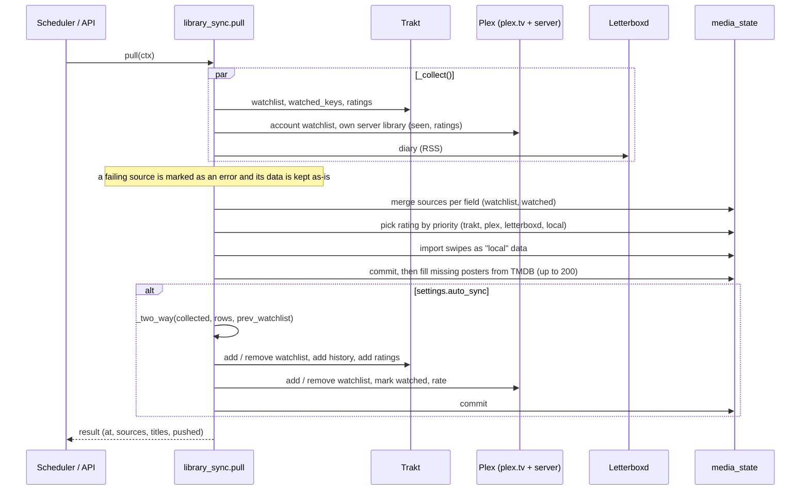

# Sync engine

The sync engine in `backend/app/services/library_sync.py` keeps one personal state per title (watchlist, watched, rating, like, dislike) in the `media_state` table, merged from Trakt, Plex (plex.tv account and Plex server), Letterboxd and the swipe history. It has three entry points: **`pull()`** collects and merges, then optionally runs the **two-way sync** (`_two_way`) that makes Trakt and Plex agree; **`act()`** applies an action taken in SynCiné to every capable service and saves it locally; **`preview()`** shows what the two-way sync would do without writing anything. The watch history used for statistics is a separate pipeline in `services/history.py`.

## When it runs

| Trigger | Code |
|---|---|
| Every 30 min, for every active account | `scheduler.py: pull_library` → `pull_one` = `pull()` + `history.import_all()` |
| App opened, or back after 5 min hidden | Frontend `useSyncOnOpen` → `POST /api/library/sync?max_age=120` (skipped if the last pull is under 2 min old) |
| "Sync now" in Profile | `POST /api/library/sync` |
| Preview before enabling auto sync | `GET /api/library/sync/preview` → `preview()` |
| Status | `GET /api/library/sync` (sources, `auto_sync`, last result) |

Pulls for one account never overlap: `_pull_locks[user_id]` is an `asyncio.Lock`. The last result is kept in memory in `_last_pull`.

## The full pull

### 1. Collect (`_collect`)

Each configured source is read in parallel with `asyncio.gather(..., return_exceptions=True)`. Each returns `{"watchlist": {key: date}, "watched": {key: date}, "ratings": {key: 1-10}, "info": {key: {title, year, poster}}}`, with `key = (media_type, tmdb_id)`.

| Source | Watchlist | Watched | Ratings |
|---|---|---|---|
| Trakt (`ctx.trakt`) | `/sync/watchlist` with `listed_at` | `/sync/watched` | `/sync/ratings` |
| Plex | plex.tv watchlist (`ctx.plex_account`); dates rebuilt from the list order | Own server library (`ctx.plex_own`): movies with a view count, shows fully watched | Server `user_rating` |
| Letterboxd | `None` (not available over RSS) | Diary entries with a TMDB id | Stars × 2 |

A `ServiceError` becomes `{"error": message}`; the source is then skipped for merging and for the two-way sync, so a service outage never looks like "everything was removed".

### 2. Merge into `media_state`

For each healthy source and each field, the source is **authoritative for what it contains**: its name is added to `<field>_sources` for every key it returned and removed from rows it no longer contains. `listed_at` is set once; `watched_at` keeps the latest date. Titles that only have a rating still get a row, so the rating is not lost.

Ratings follow `RATING_PRIORITY = ("trakt", "plex", "letterboxd", "local")`. A rating whose source no longer has it is cleared, unless that source failed this time or the rating is local.

`_import_swipes` turns swipes into local data: `like`/`watchlist` → watchlist source `local` (and `liked`), `seen` → watched source `local` plus a rating if none exists.

## Two-way sync (`_two_way`)

Runs only when `settings.auto_sync` is on. Targets are Trakt and Plex among the sources that **succeeded** this time (Plex only with a plex.tv account). Letterboxd is read-only but feeds watched titles and ratings to the others.

### Watchlist: additions and removals

For every key in any target's watchlist (plus local watchlist rows):

- **Removed somewhere** since the previous pull (the source was in the previous `watchlist_sources` but no longer has it) and still present elsewhere → remove it everywhere.
- Otherwise → add it to every target that is missing it.

The previous state (`prev_watchlist`) is snapshotted before merging; that is how an addition is told apart from a removal.

### Safeguards

| Safeguard | Rule | Why |
|---|---|---|
| **Mass-removal guard** | If removals for a service exceed `max(10, len(watchlist) // 5)`, they are all skipped with a warning | A service that suddenly "loses" many titles is more likely a read error than a user action |
| **Trakt watchlist limit** | `trakt.watchlist_limit()` (free accounts); additions beyond the room left are dropped, keeping the most recent by `listed_at` | Avoid failing writes and say why in `warnings` |
| **Failed-once memory** | `_failed_once[user_id]` remembers `(key, service, kind)` writes that failed or that Trakt returned as `not_found` | Never retry the same impossible write every 30 min |
| **No presumed marking** | Trakt additions are not marked as present until the next pull confirms them | A title Trakt refused would otherwise look "removed" and be deleted from Plex |
| **Failing source excluded** | A source with an error is not a target and its rows are not altered | Outages never propagate as removals |

### Watched titles and ratings: additions only

- **To Trakt**: every title watched somewhere but not on Trakt is sent to `/sync/history`. **Real dates** are used: for shows, each episode with its date from the imported Plex server history (`_plex_episode_history`); for others, the date known from Plex or Letterboxd (a date-only Letterboxd entry becomes 20:00 UTC). Without a known date, Trakt's `"released"` is used, never the current time, which would distort the history. Ratings missing on Trakt are copied from Plex, then Letterboxd.
- **To Plex**: watched **movies** missing on Plex are scrobbled on the server when the title is in the library (`plex_own.scrobble`), otherwise marked on plex.tv (`plex_account.mark_watched`). Ratings missing on Plex come from Trakt, then Letterboxd.
- Nothing is ever un-watched or un-rated by the automatic sync.

The returned report has `added`, `removed`, `watched`, `ratings` per service and a list of `warnings`. `preview()` runs the same planning with `dry_run=True`, then rolls back the session.

## Actions from the UI (`act`)

`/api/library/*` endpoints (`routers/library.py`) call `act(ctx, action, media_type, tmdb_id, rating10, title)`:

| Action | Trakt | Plex |
|---|---|---|
| `watchlist_add` / `watchlist_remove` | watchlist | plex.tv watchlist |
| `watched` / `unwatched` | history | server scrobble/unscrobble if in library, else plex.tv |
| `rate` | rating | server rating if in library, else plex.tv |
| `like` / `unlike` | favorites | — |
| `dislike` / `undislike` | hide / unhide recommendation | — |

Writes run in parallel; each service result is `"ok"` or an error message. **The local save always happens**, even if every service failed: additions add `local` plus the services that succeeded; removals keep only the sources of services that failed (so the next pull still reflects reality). The response is `{"services": {...}, "state": {...}}`, which the frontend turns into a toast.

## History import and statistics (`services/history.py`)

`import_all(ctx)` (per-account lock) fills `watch_events` incrementally:

| Source | How | Notes |
|---|---|---|
| Plex | `/status/sessions/history/all` of the whole server, with the admin's token, newest first until already-imported entries | Only when an admin runs it, under one global lock. Each viewing goes to the SynCiné account mapped from its Plex `accountID` (`plex_account_map`), or `0` if none |
| Trakt | `/sync/history` (`extended=full`) since the last import minus one day | 20+ entries in the same minute (`BULK_PER_MINUTE`) are a bulk import: `approx_date=True` |
| Letterboxd | Diary RSS | Date only, stored at 20:00 |

Duplicates across sources are skipped when the same title or episode is already known within 12 hours (`DUP_WINDOW`; one day for Letterboxd). `enrich_events` then fills genres and runtimes from TMDB (up to 300 titles per run).

`stats(db, period, offset, tz_offset_min)` serves `GET /api/stats/activity`: buckets for `day` (30), `week` (12), `month` (12) or `year` (all), totals, weekday and hour distribution, top genres, shows and movies, longest streak and a rating histogram. Approximate-date events count in all-time totals but not in time breakdowns. `GET /api/stats/events` lists the viewings behind one bar.

## Testing the engine

`backend/tests/test_library_sync.py` drives `pull()` and `act()` with fake services that record their calls (`FakeTrakt`, `FakePlexAccount`, `FakePlexServer`, `FakeCtx` in `conftest.py`). It covers first sync, removals, the mass-removal guard, the Trakt limit, failing services, real episode dates and not-found titles. Add a test there for any rule you change. See [Testing](10-testing.md).

## See also

- [Data model](05-data-model.md) (`media_state`, `watch_events`)
- [Integrations](08-integrations.md) (Trakt, Plex, Letterboxd clients)
- [Testing](10-testing.md)
- [Architecture](01-architecture.md) (scheduler)
