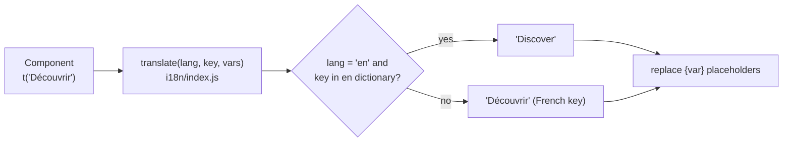

# Internationalisation

The interface is available in French, English, Italian, German and Spanish. Translation happens entirely in the frontend with a tiny home-made engine in `frontend/src/i18n`: **the French text is the key**, and one dictionary per language (`en/`, `it/`, `de/`, `es/`, same files and same keys) maps it to its translation. Dictionaries are loaded on demand (`loadLanguage`, dynamic `import()`), so each user downloads only their language; `main.jsx` loads it before the first render. Push notifications are rendered by the server from `services/messages.py` (French template as key, `TEMPLATES` for English, `TRANSLATIONS` for the others). A missing entry simply shows the French text, so the UI never has holes. The backend keeps answering in French, and known server messages are translated on the client.

## How it works



- `i18n/index.js` exports `translate`, `t`, `useT`, `currentLang`, `currentLocale`, `fmtNumber` and `UI_LANGUAGES`.
- `i18n/en/index.js` merges the per-area dictionaries: `common.js`, `discover.js`, `detail.js`, `profile.js`, `admin.js`, `auth.js`, `news.js`, `shell.js`.
- The current language is `uiLanguage` in the Zustand `useSettingsStore` (persisted locally, initialised from the browser language). The account setting `ui_language` on the server is the source of truth; `hooks/useTheme.js` copies it into the store and sets `<html lang>`.
- The language can be changed on the login screen and in Profile (`UI_LANGUAGES`); Profile saves it with `PUT /api/settings`.

## `useT()` vs `t()`

| | `useT()` | `t()` |
|---|---|---|
| Where | Inside React components | Anywhere: hooks' callbacks, toasts, `services/api.js`, `lib/format.js` |
| Re-renders on language change | Yes (subscribes to the store) | No (reads the store once) |
| Usage | `const t = useT()` then `t('Watchlist')` | `import { t } from '../i18n'` |

Rule of thumb: in JSX, use `useT()`. Use `t()` for strings created outside rendering. Some files import both as `import { t as tx, useT } from '../i18n'`.

Dates and numbers use `currentLocale()` (`fr-CH` or `en-GB`) through `Intl`, see `lib/format.js` and `fmtNumber`.

## Interpolation

Placeholders are `{name}`:

```js
t('Nouvel épisode de {title} : {code}', { title, code })
```

```js
// i18n/en/discover.js
'{n} titres': '{n} titles',
```

A placeholder with no value is left as-is.

## Plurals: two keys

There is no plural engine. Write the condition in the component and use **two keys**, one singular and one plural:

```jsx
{total > 1 ? t('{n} titres', { n: total }) : t('{n} titre', { n: total })}
```

and add both to the dictionary:

```js
'{n} titre': '{n} title',
'{n} titres': '{n} titles',
```

French uses the singular for 0 and 1, which is why the code tests `> 1`.

## Translating backend messages

The server raises French messages in `HTTPException` and `ServiceError` (see [Backend](03-backend.md#error-handling)). `services/api.js` translates them before throwing:

```js
const message = typeof detail === 'string' ? t(detail) : Array.isArray(detail) ? t('Données invalides') : t('Erreur {status}', { status: res.status })
```

So **every new French message on the backend needs an entry in every dictionary** with exactly the same text. Most live in `i18n/en/shell.js` and `i18n/en/auth.js`. A few things to watch:

- Messages built with f-strings must be added in their final form. For example `f"Le mot de passe doit faire au moins {PASSWORD_MIN} caractères"` is translated as `'Le mot de passe doit faire au moins 8 caractères'`.
- Messages that include dynamic data (a title, a service error) cannot match a dictionary key. Prefer a fixed message, or have the client build the sentence from structured data (as `syncMessage` in `hooks/useMedia.js` does for sync results).
- Pydantic validation errors (a list) become the generic `'Données invalides'`.
- Notification messages are built on the server in French and stored in the database; `NotificationPanel.jsx` displays `n.message` as-is, so they are not translated today. Results of background checks returned to the client (such as `skipped` reasons) do go through `t()`.

## Navigation and other data-driven labels

Labels stored in data structures are French keys, translated at render time: `NAV_ITEMS` in `components/layout/nav.js` (`t(label)` in `Sidebar.jsx` and `BottomBar.jsx`), option lists such as `DURATIONS` and `MOODS` in `pages/Tonight.jsx`, `SOURCE_LABELS` in `services/library.js`.

## Adding or changing a string

1. Write the French text in the component: `t('Ma nouvelle phrase')`.
2. Add it to the matching dictionary in `frontend/src/i18n/en/`:

   ```js
   'Ma nouvelle phrase': 'My new sentence',
   ```

3. The same key must not be defined differently in two dictionaries: they are merged with object spread in `i18n/en/index.js`, so the last one (`shell.js`) wins.
4. Changing the French text changes the key: update the entries in every language too, or they will silently fall back to French. `npm run check:i18n` (in `frontend/`, also run by CI) also checks that all languages have the same keys and placeholders.

## Adding a language

1. Create `frontend/src/i18n/<code>/` with the same files as `en/` (or a single file to start) and an `index.js` that merges them.
2. In `frontend/src/i18n/index.js`, register it in `DICTS` and add `{ code, label, locale }` to `UI_LANGUAGES`.
3. On the backend, allow the code in `schemas/settings.py`: `ui_language: Literal["fr", "en"]` in `SettingsUpdate`.
4. Optionally update `browserLang()` in `store/settingsStore.js` (today: French if the browser is French, otherwise English) and the default news sources in `services/news.py: DEFAULTS`, which pick French or English feeds from `ui_language`.
5. Run `npm run build` and click through every page.

Note that the TMDB content language (`language` setting, default `fr-FR`) is separate from the interface language: it controls titles and overviews returned by TMDB.

## See also

- [Frontend](04-frontend.md)
- [Backend](03-backend.md)
- [Contributing](12-contributing.md)
