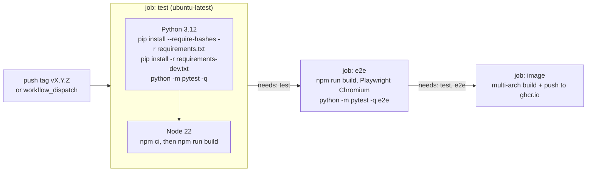

# Testing

The backend has a pytest suite in `backend/tests` that runs against a throwaway SQLite database, with fake Trakt and Plex services for the sync engine and FastAPI's `TestClient` for accounts and security. The frontend has no unit tests: its checks are a successful production build and the end-to-end suite in `e2e/`, which drives a real server in Chromium. CI runs all of them before publishing a Docker image.

## Running the tests

```bash
cd backend
. .venv/bin/activate
pip install -r requirements.txt -r requirements-dev.txt
python -m pytest -q
```

Run one file or one test:

```bash
python -m pytest tests/test_library_sync.py -q
python -m pytest -q -k "rate_limited"
```

Run pytest from `backend/` so that `app` and `tests` are importable (the tests import `from tests.conftest import ...`).

## What is covered

| File | Covers |
|---|---|
| `test_library_sync.py` | `library_sync.pull()` and `act()`: first sync both ways, removals, mass-removal guard, Trakt watchlist limit, `auto_sync` off, failing services, watched rules, rating priority, local save on failure, real episode dates, titles unknown to Trakt, paging, dislike |
| `test_accounts.py` | Migration of a pre-accounts database, per-user scoping, setup code, temporary passwords, rate limiting, logout, same-origin check, admin-only settings, deactivation, last admin protection, requests queue, personal edition, security headers, HSTS host, HTTP→HTTPS redirect, Plex PIN binding |
| `test_news.py` | Feed parsing to plain text, YouTube entries, SSRF refusals in `safe_fetch.check_url`, custom sources, signed image relay |
| `test_admin_plex.py` | Parsing of Plex dashboard sessions (direct play, transcoding, totals) |
| `test_plex_links.py` | `PlexAccount.watch_url` links and their caching |

## Fixtures and fakes (`tests/conftest.py`)

- **Isolated database**: before importing the app, `conftest.py` sets `DATA_DIR` to a new temporary folder (`tempfile.mkdtemp`). `config.py` reads it, so the engine points there. Your dev database is never touched, **as long as the test file lives in `backend/tests/`**: a test file run from elsewhere does not load `conftest.py`. The `db` and `fresh` fixtures therefore refuse to drop tables unless `DATA_DIR` is the temporary test folder (`assert_test_database`).
- **`db` fixture**: drops all tables, runs `init_db()`, clears the cache and the sync engine's in-memory state (`_failed_once`, `_last_pull`), and yields a session **bound to user 1** (`bind_user(session, 1)`), like a request from the admin.
- **`FakeTrakt`**: in-memory watchlist, watched set and ratings; options `limit` (watchlist limit), `fail` (raises `ServiceError`), `not_found`. Every write is recorded in `calls`, for example `("/sync/watchlist", [refs])` or `("add", key)`.
- **`FakePlexAccount`**: plex.tv watchlist; `fail_writes=True` makes every write raise.
- **`FakePlexServer`**: a server library (`library()`, `index()`), records `scrobble` and `rate`.
- **`FakeCtx`**: a minimal stand-in for `Ctx` with `db`, `settings` (row 1), `user`, `trakt`, `plex_account`, `plex`/`plex_own`, `letterboxd=None` and a `FakeTMDB` whose `is_mock = True` (no poster lookups).
- **`lib_item(mt, tid, rk, **kw)`**: builds a library item shaped like `PlexClient.library()` output.

## Account and HTTP tests (`test_accounts.py`)

These tests go through the real app with `fastapi.testclient.TestClient`:

- The `fresh` fixture rebuilds the database, clears the cache and resets `auth.login_limiter`.
- `client()` returns a `TestClient` with `Origin: http://testserver`, so unsafe requests pass the same-origin check.
- Helpers: `setup_admin(c)` uses `database.setup_code`; `add_member(admin, ...)`; `login(username, password)`; `member(admin, username)` creates a member and changes its temporary password.
- Each `TestClient` keeps its own cookie jar, so you can hold an admin and a member session side by side.
- Edition-dependent behaviour is tested with `monkeypatch.setattr(config, "cinesync_mode", "personal")`. Values that `main.py` computes once at import (HSTS host, public host) are tested by patching `config` and then `importlib.reload(app.main)`, reloading again in a `finally` block.

## Writing a test

**Sync rule** (pure engine, no HTTP):

```python
import asyncio
from app.services import library_sync
from tests.conftest import FakeCtx, FakePlexAccount, FakeTrakt

def test_new_trakt_title_reaches_plex(db):
    trakt = FakeTrakt(watchlist=[("movie", 1)])
    plex = FakePlexAccount(watchlist=[])
    asyncio.run(library_sync.pull(FakeCtx(db, trakt=trakt, plex_account=plex)))
    assert ("add", ("movie", 1)) in plex.calls
```

**Endpoint** (through the API, in `test_accounts.py`, which defines these helpers):

```python
def test_members_cannot_list_users(fresh):
    admin = client()
    setup_admin(admin)
    alice = member(admin)
    assert alice.get("/api/admin/users").status_code == 403
```

Tips:

- Name tests as sentences describing the behaviour (`test_title_removed_on_one_side_is_removed_on_the_other`).
- Never call real external services: use or extend the fakes. If you add a method to a client that the sync engine calls, add it to the matching fake.
- Async code is run with `asyncio.run(...)`; there is no pytest-asyncio dependency.
- In-memory module state (rate limiter, caches, pending PINs) persists between tests: reset what you rely on in your fixture.

## Frontend checks

There is no JavaScript test runner or linter configured. Before opening a pull request:

```bash
cd frontend
npm run build      # must succeed: catches syntax errors and broken imports
```

Then check the change in the browser, in both themes, in French and English, and at phone width. Make sure every new French string has an English entry (see [Internationalisation](09-i18n.md)).

## End-to-end tests (`e2e/`)

`e2e/` runs the real app in a browser with Playwright: `conftest.py` starts a fresh server (empty database in a temporary folder, the compiled interface from `frontend/dist`, no TMDB key so demo data is shown), reads the setup code from its log and installs SynCiné through the interface once per run (admin account, first-run assistant skipped). `test_app.py` then checks:

- the main pages load without uncaught JavaScript errors;
- the Profile tabs, an immediate backup, the old `/admin` address, settings search and switching the interface language;
- a member created by the admin signs in, must change the temporary password and has no Admin tab or admin API access;
- phone layout (iPhone 13): bottom bar, no horizontal overflow, the four Profile tabs fit the width;
- personal edition (second server, `personal_server` fixture): protecting access asks for the security code written to the server logs, then another device has to sign in.

```bash
cd frontend && npm run build && cd ..
pip install -r backend/requirements.txt -r e2e/requirements.txt
python -m playwright install chromium
python -m pytest -q e2e        # E2E_PYTHON=… to start the server with another Python
```

Selectors use the French interface (`locale="fr-FR"`) and visible labels; when you rename a button or a label used there, update the test.

## What CI runs

`.github/workflows/ci.yml` ("Vérifications") runs on every push to `main` and every pull request that touches `backend/` or `frontend/`: the backend tests, the translation check (`npm run check:i18n`) and the frontend build, in a single job that is cancelled when a newer push arrives. The end-to-end tests are not part of it (they take longer); they run before a release.

`.github/workflows/docker.yml` ("Image Docker") runs on tags `v*.*.*` and on manual dispatch:



The image is only built and published if the tests, the frontend build and the end-to-end tests pass. Actions are pinned by commit SHA, and the workflow has read-only `contents` permission; only the `image` job gets `packages: write`. See [Release and deploy](11-release-and-deploy.md).

The end-to-end tests only run in CI on release tags: **run them locally when you change the interface or the sign-in flows**.

## See also

- [Development setup](02-dev-setup.md)
- [Sync engine](07-sync-engine.md)
- [Accounts and security](06-accounts-and-security.md)
- [Release and deploy](11-release-and-deploy.md)
- [Contributing](12-contributing.md)
