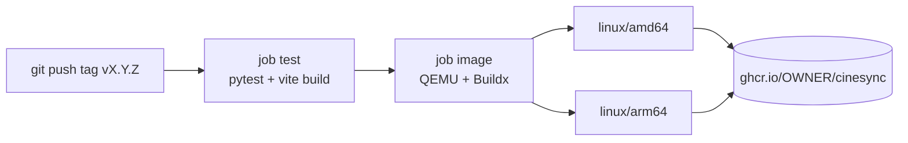

# Release and deploy

A SynCiné release is a git tag `vX.Y.Z`. Pushing the tag runs a GitHub Actions workflow that tests the code, builds a multi-architecture Docker image and publishes it to the GitHub Container Registry. Users then deploy that image with Docker Compose or the Unraid template, usually behind an HTTPS reverse proxy. This page covers versioning, the publishing pipeline, deployment options and dependency updates.

## Versioning

The version lives in two places, which must always match:

| File | Field | Used by |
|---|---|---|
| `backend/app/__init__.py` | `__version__ = "X.Y.Z"` | FastAPI app version, `GET /api/health` (shown in the sidebar and in Profile → About), `X-Plex-Version` header (`plex_auth.py`), Trakt user agent (`trakt_client.py`) |
| `frontend/package.json` | `"version"` | npm metadata |

Each version also needs a `## X.Y.Z - YYYY-MM-DD` section in `CHANGELOG.md` (English, written for users): it becomes the version's GitHub Release page.

The backend version is the one users see. The Docker image also gets an OCI label `org.opencontainers.image.version` from the `VERSION` build argument (the tag name in CI, `dev` by default).

The project uses semantic versioning: patch for fixes, minor for features, major for breaking changes (for example a migration that cannot be rolled back, or a changed environment variable).

### Cutting a release

1. Make sure `main` is green locally: `python -m pytest -q` in `backend/`, `npm run build` in `frontend/`.
2. Bump `__version__` in `backend/app/__init__.py` and `version` in `frontend/package.json` (and `package-lock.json`, for example with `npm version X.Y.Z --no-git-tag-version`).
3. Commit: `Version X.Y.Z`.
4. Tag and push: `git tag vX.Y.Z && git push origin main vX.Y.Z`.
5. Watch the "Image Docker" workflow, then check that `GET /api/health` on a fresh container reports the new version.

## Publishing pipeline

`.github/workflows/docker.yml` runs on tags matching `v*.*.*` and on manual dispatch (`workflow_dispatch`).



- **Platforms**: `linux/amd64` (PCs, most Unraid servers) and `linux/arm64` (Raspberry Pi, Apple Silicon).
- **Tags** (via `docker/metadata-action`): `X.Y.Z`, `X.Y`, `latest`, and `sha-<short sha>`.
- **Registry**: `ghcr.io/${{ github.repository_owner }}/syncine`, so `ghcr.io/gauffrepierre/syncine` for the main repository.
- **Build cache**: GitHub Actions cache (`cache-from/to: type=gha`).
- **Hardening**: every action is pinned to a commit SHA, checkout does not persist credentials, the workflow's default permission is `contents: read`, and only the `image` job gets `packages: write`.

**GitHub Releases** (`.github/workflows/release.yml`, on every `v*.*.*` tag or by hand): for each `## X.Y.Z` section of `CHANGELOG.md` whose tag exists, it creates or updates the release `vX.Y.Z` (title `SynCiné X.Y.Z`, the section as notes, plus the `docker pull` line from 1.1.0). Earlier versions without a release are created on the way, and the newest one is marked *Latest*. Only this job gets `contents: write`.

## Deploying

### Docker Compose

The repository's `docker-compose.yml` defines one service, `cinesync`, which builds from the `Dockerfile` (or pulls `ghcr.io/gauffrepierre/syncine:latest` if you remove `build: .`), maps `${CINESYNC_BIND}:${CINESYNC_PORT}` to container port 8000, mounts `${DATA_PATH}` on `/app/data` and reads `.env`. Start from `.env.example`.

The container:

- starts with `docker/entrypoint.sh`, which sets ownership of `/app/data` to `PUID:PGID`, restricts permissions (`umask 077`, folder `700`, files `600`) and drops root with `setpriv`;
- runs `uvicorn app.main:app --host 0.0.0.0 --port 8000 --proxy-headers`;
- has a `HEALTHCHECK` on `/api/health` every 60 s.

Updating is `git pull && docker compose up -d --build` (or `docker compose pull && docker compose up -d`). The database is migrated at startup (see [Data model](05-data-model.md#lightweight-migrations)).

### Unraid template

`unraid/syncine.xml` is a Docker template for Unraid's Docker manager. It points at `ghcr.io/gauffrepierre/syncine:latest` and exposes:

| Setting | Target | Default |
|---|---|---|
| Web interface port | container `8000` | host `3000` |
| Data | `/app/data` | `/mnt/user/appdata/syncine` |
| `CINESYNC_MODE` | variable | `server` |
| `PUBLIC_URL` | variable | empty |
| `TZ` | variable | `Europe/Paris` |
| `PUID` / `PGID` (advanced) | variables | `99` / `100` (`nobody:users`) |

Users download the file into `/boot/config/plugins/dockerMan/templates-user/` and add the container from the template list. Its `TemplateURL` (raw GitHub URL of the file in the public repo) lets Unraid refresh installed templates. If you add an environment variable that users may need to set, add it to the template too.

`ca_profile.xml` at the repository root is the repository profile required by Unraid Community Applications (submission at https://ca.unraid.net/submit: an Unraid account, the public repo URL, an automatic scan, then the next catalog build).

### Behind a reverse proxy (HTTPS)

Installing the PWA requires HTTPS. The usual setups are `tailscale serve` on the host, or a reverse proxy (Caddy, Nginx Proxy Manager, SWAG…) with a domain. The README has step-by-step examples; here is what matters for the code:

| Setting | Why |
|---|---|
| `PUBLIC_URL=https://…` | Trakt OAuth redirect URL, `Secure` cookies, its origin is always accepted by the same-origin check, and it enables the HTTP→HTTPS redirect for that host |
| `CINESYNC_BIND=127.0.0.1` | The plain-HTTP port is no longer reachable from the network, only from the proxy on the same host |
| `FORWARDED_ALLOW_IPS` | uvicorn trusts `X-Forwarded-For` / `X-Forwarded-Proto` only from these addresses. Default `127.0.0.1,172.16.0.0/12` covers the host and Docker networks |
| `HSTS_SECONDS` | Only for a dedicated domain; HSTS is sent only on the `PUBLIC_URL` host |

> **Add your proxy to `FORWARDED_ALLOW_IPS`.** If it isn't listed, uvicorn ignores its `X-Forwarded-For` / `X-Forwarded-Proto` headers: every visitor appears to come from the proxy's address, so the login rate limiter treats them all as one client. (The HTTPS redirect itself does not loop: it is skipped when the proxy announces `X-Forwarded-Proto: https`.)

**Proxy in another container.** If the proxy runs in its own container (Nginx Proxy Manager…), `127.0.0.1` on the host is not reachable from it. Keep the main `docker-compose.yml` untouched and add a server-specific `docker-compose.override.yml` (ignored by git) that publishes the port on the Docker bridge gateway address only:

```yaml
services:
  cinesync:
    ports:
      - "<docker-bridge-gateway>:3000:8000"   # reachable from containers, not from the LAN
```

Point the proxy at that address and port, and make sure the proxy's address is in `FORWARDED_ALLOW_IPS`.

### Backups

Everything is in the data folder: `cinesync.db` (accounts, settings, tokens, state), `secret.key` (signs image URLs), `cache/` (disposable) and `backups/`.

`services/backup.py` makes a consistent online copy with SQLite's backup API (safe with WAL), gzips it to `backups/syncine-YYYYMMDD-HHMMSS.db.gz` (mode 600) and keeps the newest `backup_keep` files. The scheduler job `db_backup` runs hourly and backs up when the newest file is older than 23 hours and `backup_enabled` is on (server settings, row 1). The admin endpoints are under `/api/admin/backups` (list, create, settings, download, delete); file names are validated against `NAME_RE`, so nothing else in the data folder can be reached. Treat backups as secrets.

Restore with the container stopped: decompress the file over `cinesync.db`, delete `cinesync.db-wal` and `cinesync.db-shm`, start again. The entrypoint fixes ownership and permissions on start.

## Dependency updates: Dependabot

`.github/dependabot.yml` opens **one grouped pull request per ecosystem per week**, for minor and patch updates only:

| Ecosystem | Directory |
|---|---|
| `github-actions` | `/` |
| `pip` | `/backend` (`requirements.in` + the pip-compile lock `requirements.txt`, regenerated with hashes) |
| `pip` | `/e2e` (end-to-end test tools) |
| `npm` | `/frontend` |
| `docker` | `/` (base images in the `Dockerfile`) |

Major versions are ignored on purpose: they are done by hand, after reading the changelog and testing. When merging a Dependabot PR, run the backend tests and the frontend build locally, since CI only runs on release tags. The public repository only receives one commit per version, so a Dependabot PR there is applied in the development repository instead (for Python: change `requirements.in`, regenerate the lock, see [Development setup](02-dev-setup.md)); Dependabot closes it once the published version contains the update.

The Docker image installs the Python lock with `--require-hashes`: a package whose content differs from the recorded SHA-256 (republished or tampered with) makes the build fail instead of ending up in the image.

## See also

- [Development setup](02-dev-setup.md)
- [Testing](10-testing.md)
- [Accounts and security](06-accounts-and-security.md)
- [README: installation and HTTPS access](../../README.en.md#installation)
