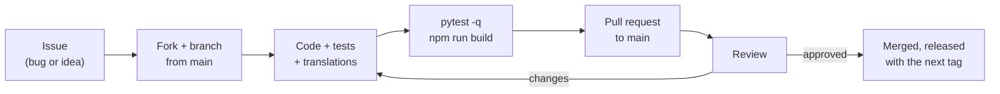

# Contributing

Contributions are welcome, from a typo fix to a new integration. This page explains how to propose a change: open or pick an issue, work on a branch, follow the existing code style, keep the tests green, write a clear commit message and open a pull request on `GauffrePierre/cinesync`. Security problems follow a separate, private path. CinéSync is free software under the GNU AGPL-3.0.

## Before you start

- **Bugs and ideas** go in the GitHub issues. For a bug, include the version (sidebar or `GET /api/health`), the edition (`server` or `personal`), which services are connected, the steps to reproduce, and the container logs if relevant. Remove tokens, addresses and personal data from logs before posting.
- **Bigger changes** (a new page, a new integration, a schema change): open an issue first to agree on the approach. It saves everyone time.
- **Security issues**: never in a public issue. See [Security](#reporting-a-security-issue) below.

## Workflow



1. Fork the repository and create a branch from `main` with a short descriptive name (`fix-trakt-limit`, `feature-cinema-filter`).
2. Set up your environment ([Development setup](02-dev-setup.md)).
3. Make focused changes: one topic per pull request.
4. Run the checks (below), then open a pull request against `main`. Describe what changed, why, and how you tested it. Add screenshots for UI changes (phone and desktop, ideally both themes).

## Code style

There is no enforced formatter or linter; consistency with the surrounding code is what matters.

### Python (backend)

- Type hints on function signatures (`def state_of(db, media_type: str, tmdb_id: int) -> dict`).
- Small functions with one job. Thin routers; logic in `services/`.
- A module docstring explaining what the module is for and its rules.
- **Comments and docstrings in French**: this is the existing convention of the codebase. Keep a file consistent.
- **User-facing messages in French** (`HTTPException`, `ServiceError`, notifications), and add their English translation in `frontend/src/i18n/en/`.
- Async I/O for external services, `asyncio.gather` for independent calls, a `Semaphore` to cap concurrency.
- Use `ctx.db` for personal data and keep `execution_options(all_users=True)` to admin or global code ([Data model](05-data-model.md)).
- Never return secrets or tokens to the client; never fetch a user-supplied URL without `services/safe_fetch.py` ([Accounts and security](06-accounts-and-security.md)).

### JavaScript / React (frontend)

- Function components and hooks only.
- Server data through TanStack Query hooks with explicit query keys; client-only state in the Zustand stores.
- API calls in `src/services/`, never `fetch` directly in components.
- Every visible string through `useT()` or `t()`, with an English entry ([Internationalisation](09-i18n.md)).
- Styling with Tailwind classes based on the design tokens (`bg-bg2`, `text-text2`, `border-line`…), mobile first, both themes.
- No inline scripts or third-party origins: the Content-Security-Policy in `backend/app/main.py` would block them.

## Tests are required

| Change | Expected |
|---|---|
| Backend logic, sync rules | A pytest test in `backend/tests/` ([Testing](10-testing.md)) |
| New endpoint with permissions | A `TestClient` test for admin, member and anonymous access |
| Schema change | A migration test from an older database shape |
| Frontend | `npm run build` passes, manual check in French and English, phone and desktop |

Before pushing:

```bash
cd backend && python -m pytest -q
cd ../frontend && npm run build
```

## Commit messages

Look at `git log` for the style. Messages are in **English**, one short summary line that says what changed for the user or the code, often prefixed by the area:

```
PWA: check for a new version on open, on return to the app and hourly
HSTS only on the public domain; reverse proxy in another container
Login screen: no Plex server name (also removed from the public /auth/me), centered title
```

- Summary line under about 80 characters when possible; details in the body if needed.
- One logical change per commit.
- If an AI assistant co-wrote the change, credit it with a `Co-Authored-By:` trailer, as existing commits do.

## Reporting a security issue

Please do **not** open a public issue. Use GitHub's private vulnerability reporting: the repository's **Security → Report a vulnerability** tab, as described in [SECURITY.md](../../SECURITY.md). Include the affected version, steps to reproduce and the possible impact.

## License

CinéSync is released under the **GNU Affero General Public License v3.0** ([LICENSE](../../LICENSE), `AGPL-3.0-only` in `frontend/package.json` and the Docker image label). By contributing, you agree that your contribution is licensed under the same terms. In short: anyone may use, study, modify and share CinéSync, and any modified version, including one offered as a network service, must remain free under the same license.

Respect the terms of the services CinéSync uses. In particular, keep the TMDB attribution ([Integrations](08-integrations.md#tmdb--tmdb_clientpy)).

## Credits

- **Pierre Gauffre**: creator of CinéSync, and development.
- **Claude** ([Anthropic](https://www.anthropic.com)): development. Claude wrote much of the code and documentation under Pierre's direction; its contributions appear as co-author on the commits.

Thanks to everyone who reports bugs, suggests ideas and sends pull requests. If you enjoy CinéSync, the README has a link to support the project.

## See also

- [Development setup](02-dev-setup.md)
- [Testing](10-testing.md)
- [Internationalisation](09-i18n.md)
- [Release and deploy](11-release-and-deploy.md)
- [SECURITY.md](../../SECURITY.md)
