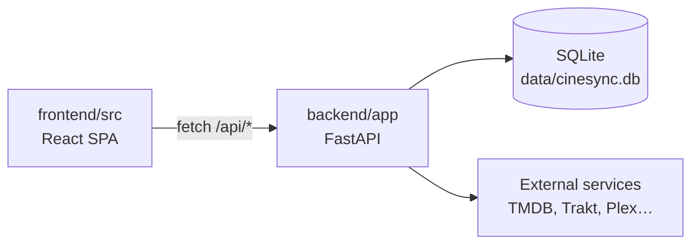

# CinéSync developer wiki

Welcome! This wiki is for developers who want to understand, run and improve CinéSync. CinéSync is a self-hosted PWA for film lovers: it brings together TMDB, Trakt, JustWatch, Plex, Letterboxd, Seerr and local cinema showtimes, keeps your watchlist in sync across services and suggests what to watch. It is a FastAPI + SQLite backend and a React 18 + Vite + Tailwind v4 frontend, shipped as a single Docker image.

For the product overview, installation and user settings, start with the main [README](../../README.en.md). This wiki covers how the code works.

## Pages

| # | Page | What you will find |
|---|---|---|
| 1 | [Architecture](01-architecture.md) | The big picture: one container, API + SPA, SQLite, scheduler, cache, PWA |
| 2 | [Development setup](02-dev-setup.md) | Running backend and frontend locally, environment variables, tests, Docker build |
| 3 | [Backend](03-backend.md) | Layout of `backend/app`, request flow, error handling, adding an endpoint |
| 4 | [Frontend](04-frontend.md) | Layout of `frontend/src`, TanStack Query, Zustand, auth gate, navigation, styling, adding a page |
| 5 | [Data model](05-data-model.md) | SQLAlchemy models, automatic per-user scoping, lightweight migrations |
| 6 | [Accounts and security](06-accounts-and-security.md) | Editions, sessions, passwords, rate limiting, Plex login, CSRF, CSP, SSRF |
| 7 | [Sync engine](07-sync-engine.md) | How watchlists, watched titles and ratings are merged and synced both ways |
| 8 | [Integrations](08-integrations.md) | Every external service client: purpose, auth, caching, official or not |
| 9 | [Internationalisation](09-i18n.md) | French keys, English dictionaries, `useT()` / `t()`, adding a language |
| 10 | [Testing](10-testing.md) | The pytest suite, fakes and fixtures, frontend checks, CI |
| 11 | [Release and deploy](11-release-and-deploy.md) | Versioning, image publishing, Unraid template, reverse proxy, Dependabot |
| 12 | [Contributing](12-contributing.md) | Issues, pull requests, code style, commit messages, security, license, credits |

## Quick orientation

- New here? Read [Architecture](01-architecture.md), then [Development setup](02-dev-setup.md).
- Fixing a sync bug? Go to [Sync engine](07-sync-engine.md) and [Testing](10-testing.md).
- Adding a feature end to end? [Backend](03-backend.md) → [Frontend](04-frontend.md) → [Internationalisation](09-i18n.md).

## A note on language

The code comments and the server's user-facing messages are in **French**: that is the project's existing convention. The interface is translated to English on the client side (see [Internationalisation](09-i18n.md)). This wiki is in English.

## See also

- [README (English)](../../README.en.md) and [README (Français)](../../README.md)
- [SECURITY.md](../../SECURITY.md)
- [LICENSE](../../LICENSE) (GNU AGPL-3.0)
